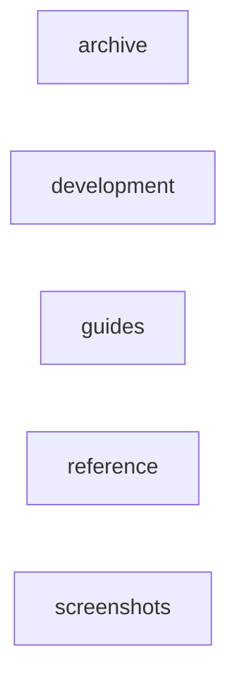

_Generated by CodeAtlas._

## Details

Owns 0 symbols across 1 file(s).

### archive

Owns 0 symbols across 63 file(s).

**Related Classes/Methods:** _None_

### development

Owns 0 symbols across 2 file(s).

**Related Classes/Methods:** _None_

### guides

Owns 0 symbols across 13 file(s).

**Related Classes/Methods:** _None_

### reference

Owns 0 symbols across 7 file(s).

**Related Classes/Methods:** _None_

### screenshots

Owns 0 symbols across 4 file(s).

**Related Classes/Methods:** _None_
