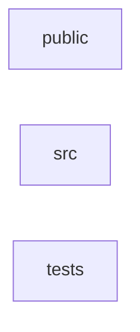

_Generated by CodeAtlas._

## Details

Owns 0 symbols across 14 file(s).

### public

Owns 0 symbols across 2 file(s).

**Related Classes/Methods:** _None_

### src

Owns 20 symbols across 6 file(s).

**Related Classes/Methods:** _None_

**Source Files:**

- `frontend/src/App.tsx`
  - `frontend.src.App.App`
  - `frontend.src.App.applyTheme`
  - `frontend.src.App.close`
  - `frontend.src.App.closeCenterOverlays`
  - `frontend.src.App.handler`
  - `frontend.src.App.newNotebook`
  - `frontend.src.App.onKey`
  - `frontend.src.App.onResize`
  - `frontend.src.App.openExplorer`
  - `frontend.src.App.openFile`
  - `frontend.src.App.openTableMeta`
  - `frontend.src.App.openVizFor`
  - `frontend.src.App.railBtn`
  - `frontend.src.App.runAll`
  - `frontend.src.App.saveCurrent`
  - `frontend.src.App.showExplorer`
  - `frontend.src.App.toggleCenter`
  - `frontend.src.App.togglePanel`
  - `frontend.src.App.toggleTheme`
- `frontend/src/AppWrapper.tsx`
  - `frontend.src.AppWrapper.AppWrapper`

### tests

Owns 0 symbols across 2 file(s).

**Related Classes/Methods:** _None_
