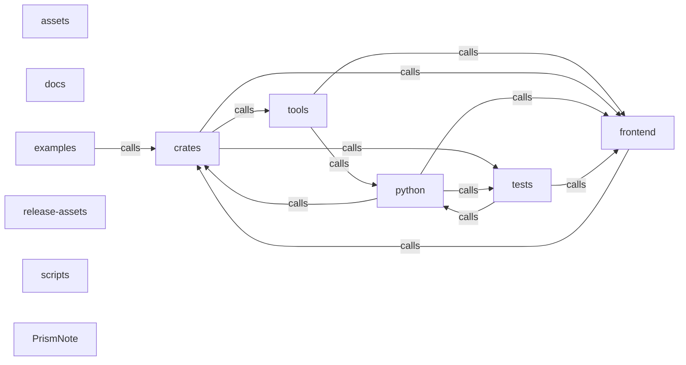

_Generated by CodeAtlas._

## Details

Architecture map of PrismNote.

### assets

Owns 0 symbols across 1 file(s).

**Related Classes/Methods:** _None_

### crates

Owns 0 symbols across 0 file(s).

**Related Classes/Methods:** _None_

### docs

Owns 0 symbols across 1 file(s).

**Related Classes/Methods:** _None_

### examples

Owns 2 symbols across 3 file(s).

**Related Classes/Methods:** _None_

**Source Files:**

- `examples/mcp_prismnote.py`
  - `examples.mcp_prismnote.main`
- `examples/mcp_queries.py`
  - `examples.mcp_queries.main`

### frontend

Owns 0 symbols across 14 file(s).

**Related Classes/Methods:** _None_

### python

Owns 0 symbols across 2 file(s).

**Related Classes/Methods:** _None_

### release-assets

Owns 0 symbols across 14 file(s).

**Related Classes/Methods:** _None_

### scripts

Owns 1 symbols across 8 file(s).

**Related Classes/Methods:** _None_

**Source Files:**

- `scripts/capture_screenshots.py`
  - `scripts.capture_screenshots.capture_screenshots`

### tests

Owns 134 symbols across 7 file(s).

**Related Classes/Methods:** _None_

**Source Files:**

- `tests/test_codeatlas_adapter.py`
  - `tests.test_codeatlas_adapter._run`
  - `tests.test_codeatlas_adapter.test_check_reports_the_embedded_engine_available`
  - `tests.test_codeatlas_adapter.test_diagnose_summarises_the_architecture_map`
  - `tests.test_codeatlas_adapter.test_explain_reports_an_unknown_node_as_an_error`
  - `tests.test_codeatlas_adapter.test_god_nodes_are_ranked_by_degree`
- `tests/test_link_preview.py`
  - `tests.test_link_preview._Error`
  - `tests.test_link_preview._Error.__init__`
  - `tests.test_link_preview._Meta`
  - `tests.test_link_preview._Meta.__init__`
  - `tests.test_link_preview._Page`
  - `tests.test_link_preview._Page.__init__`
  - `tests.test_link_preview._Page.is_ok`
  - `tests.test_link_preview._Result`
  - `tests.test_link_preview._Result.__init__`
  - `tests.test_link_preview._flask_client`
  - `tests.test_link_preview._install_fake_mudfish`
  - `tests.test_link_preview._install_fake_mudfish.crawl`
  - `tests.test_link_preview.test_builds_preview_from_metadata`
  - `tests.test_link_preview.test_crawl_exception_is_wrapped`
  - `tests.test_link_preview.test_missing_mudfish_raises_actionable_error`
  - `tests.test_link_preview.test_no_pages_surfaces_crawl_error`
  - `tests.test_link_preview.test_preview_route_reports_error`
  - `tests.test_link_preview.test_preview_route_requires_url`
  - `tests.test_link_preview.test_preview_route_returns_card`
  - `tests.test_link_preview.test_preview_to_dict_is_serializable`
  - `tests.test_link_preview.test_private_network_url_is_not_unblocked`
  - `tests.test_link_preview.test_rejects_missing_host`
  - `tests.test_link_preview.test_rejects_non_http_scheme`
- `tests/test_middleware.py`
  - `tests.test_middleware.TestErrorHandlingMiddlewareInformationDisclosure`
  - `tests.test_middleware.TestErrorHandlingMiddlewareInformationDisclosure.setup_method`
  - `tests.test_middleware.TestErrorHandlingMiddlewareInformationDisclosure.test_unexpected_exception_does_not_leak_internal_details`
  - `tests.test_middleware.TestErrorHandlingMiddlewareInformationDisclosure.test_unexpected_exception_returns_generic_500`
  - `tests.test_middleware.TestErrorHandlingMiddlewareInformationDisclosure.test_value_error_intentionally_does_include_detail`
  - `tests.test_middleware.TestErrorHandlingMiddlewareStatusCodes`
  - `tests.test_middleware.TestErrorHandlingMiddlewareStatusCodes.setup_method`
  - `tests.test_middleware.TestErrorHandlingMiddlewareStatusCodes.test_file_not_found_maps_to_404_without_leaking_path`
  - `tests.test_middleware.TestErrorHandlingMiddlewareStatusCodes.test_permission_error_maps_to_403_without_leaking_detail`
  - `tests.test_middleware.TestErrorHandlingMiddlewareStatusCodes.test_success_path_is_unaffected`
  - `tests.test_middleware.TestErrorHandlingMiddlewareStatusCodes.test_timeout_maps_to_408`
  - `tests.test_middleware.TestErrorHandlingMiddlewareStatusCodes.test_value_error_maps_to_400`
  - `tests.test_middleware.TestRequestLoggingMiddleware`
  - `tests.test_middleware.TestRequestLoggingMiddleware.setup_method`
  - `tests.test_middleware.TestRequestLoggingMiddleware.test_does_not_log_sensitive_query_params_or_body`
  - `tests.test_middleware.TestRequestLoggingMiddleware.test_request_completes_normally`
  - `tests.test_middleware.TestSecurityHeadersMiddleware`
  - `tests.test_middleware.TestSecurityHeadersMiddleware.setup_method`
  - `tests.test_middleware.TestSecurityHeadersMiddleware.test_adds_all_expected_security_headers`
  - `tests.test_middleware.TestSecurityHeadersMiddleware.test_content_security_policy_restricts_default_src_to_self`
  - `tests.test_middleware._error_app`
  - `tests.test_middleware._error_app.internal_secret_leak`
  - `tests.test_middleware._error_app.not_found`
  - `tests.test_middleware._error_app.ok`
  - `tests.test_middleware._error_app.permission_error`
  - `tests.test_middleware._error_app.timeout`
  - `tests.test_middleware._error_app.value_error`
  - `tests.test_middleware._headers_app`
  - `tests.test_middleware._headers_app.root`
  - `tests.test_middleware._logging_app`
  - `tests.test_middleware._logging_app.get_notebook`
- `tests/test_python_bindings.py`
  - `tests.test_python_bindings.test_prismnote_import`
  - `tests.test_python_bindings.test_prismnote_version`
- `tests/test_rate_limit.py`
  - `tests.test_rate_limit.FakeClock`
  - `tests.test_rate_limit.FakeClock.__call__`
  - `tests.test_rate_limit.FakeClock.__init__`
  - `tests.test_rate_limit.FakeClock.advance`
  - `tests.test_rate_limit.TestPerClientRateLimiter`
  - `tests.test_rate_limit.TestPerClientRateLimiter.test_cleanup_is_a_noop_when_nothing_is_stale`
  - `tests.test_rate_limit.TestPerClientRateLimiter.test_cleanup_removes_stale_clients`
  - `tests.test_rate_limit.TestPerClientRateLimiter.test_clients_are_isolated`
  - `tests.test_rate_limit.TestPerClientRateLimiter.test_enforces_burst_limit_per_client`
  - `tests.test_rate_limit.TestPerClientRateLimiter.test_low_rpm_allows_periodic_requests`
  - `tests.test_rate_limit.TestQueryRateLimiterConcurrency`
  - `tests.test_rate_limit.TestQueryRateLimiterConcurrency.test_blocks_once_max_concurrent_reached`
  - `tests.test_rate_limit.TestQueryRateLimiterConcurrency.test_end_query_frees_a_slot`
  - `tests.test_rate_limit.TestQueryRateLimiterConcurrency.test_end_query_never_goes_negative`
  - `tests.test_rate_limit.TestQueryRateLimiterConcurrency.test_start_query_is_a_noop_when_over_limit`
  - `tests.test_rate_limit.TestQueryRateLimiterHourlyWindow`
  - `tests.test_rate_limit.TestQueryRateLimiterHourlyWindow.test_blocks_once_hourly_limit_reached`
  - `tests.test_rate_limit.TestQueryRateLimiterHourlyWindow.test_hourly_window_expires_old_entries`
  - `tests.test_rate_limit.TestRateLimiterBurst`
  - `tests.test_rate_limit.TestRateLimiterBurst.test_allows_up_to_burst_size_then_blocks`
  - `tests.test_rate_limit.TestRateLimiterBurst.test_different_clients_have_independent_buckets`
  - `tests.test_rate_limit.TestRateLimiterReplenishment`
  - `tests.test_rate_limit.TestRateLimiterReplenishment.test_get_retry_after_reports_positive_wait_when_exhausted`
  - `tests.test_rate_limit.TestRateLimiterReplenishment.test_get_retry_after_zero_when_tokens_available`
  - `tests.test_rate_limit.TestRateLimiterReplenishment.test_tokens_never_exceed_burst_size`
  - `tests.test_rate_limit.TestRateLimiterReplenishment.test_tokens_replenish_after_elapsed_time`
  - `tests.test_rate_limit.clock`
- `tests/test_security.py`
  - `tests.test_security.TestFileAccessValidatorPathTraversal`
  - `tests.test_security.TestFileAccessValidatorPathTraversal.test_rejects_absolute_path_escaping_base_dir`
  - `tests.test_security.TestFileAccessValidatorPathTraversal.test_rejects_relative_traversal_out_of_base_dir`
  - `tests.test_security.TestFileAccessValidatorPathTraversal.test_validate_for_read_missing_file_raises`
  - `tests.test_security.TestFileAccessValidatorPathTraversal.test_validate_for_read_rejects_directory`
  - `tests.test_security.TestFileAccessValidatorPathTraversal.test_validate_for_write_rejects_missing_parent`
  - `tests.test_security.TestFileAccessValidatorPathTraversal.test_validate_for_write_rejects_traversal`
  - `tests.test_security.TestFileAccessValidatorValidPaths`
  - `tests.test_security.TestFileAccessValidatorValidPaths.test_validate_for_read_returns_existing_file`
  - `tests.test_security.TestFileAccessValidatorValidPaths.test_validate_for_write_allows_new_file_in_existing_dir`
  - `tests.test_security.TestFileAccessValidatorValidPaths.test_validates_nested_relative_path`
  - `tests.test_security.TestFileAccessValidatorValidPaths.test_validates_simple_relative_path`
  - `tests.test_security.TestNotebookRequestPathTraversal`
  - `tests.test_security.TestNotebookRequestPathTraversal.test_rejects_bare_dotdot_via_traversal_check`
  - `tests.test_security.TestNotebookRequestPathTraversal.test_rejects_content_over_max_length`
  - `tests.test_security.TestNotebookRequestPathTraversal.test_rejects_empty_name`
  - `tests.test_security.TestNotebookRequestPathTraversal.test_rejects_invalid_characters`
  - `tests.test_security.TestNotebookRequestPathTraversal.test_rejects_name_over_max_length`
  - `tests.test_security.TestNotebookRequestPathTraversal.test_rejects_traversal_payloads_containing_separators`
  - `tests.test_security.TestNotebookRequestValid`
  - `tests.test_security.TestNotebookRequestValid.test_accepts_content_at_max_length`
  - `tests.test_security.TestNotebookRequestValid.test_accepts_none_content`
  - `tests.test_security.TestNotebookRequestValid.test_accepts_simple_alnum_name`
  - `tests.test_security.base_dir`
  - `tests.test_security.validator`
- `tests/test_sql_validator.py`
  - `tests.test_sql_validator.TestSafeExecute`
  - `tests.test_sql_validator.TestSafeExecute.test_executes_valid_query_with_parameters`
  - `tests.test_sql_validator.TestSafeExecute.test_rejects_injection_payload_before_touching_cursor`
  - `tests.test_sql_validator.TestSafeExecute.test_rejects_invalid_query_before_touching_cursor`
  - `tests.test_sql_validator.TestSanitizeIdentifier`
  - `tests.test_sql_validator.TestSanitizeIdentifier.test_accepts_valid_identifiers`
  - `tests.test_sql_validator.TestSanitizeIdentifier.test_rejects_malicious_or_invalid_identifiers`
  - `tests.test_sql_validator.TestValidateSqlQueryAccepts`
  - `tests.test_sql_validator.TestValidateSqlQueryAccepts.test_accepts_read_only_queries`
  - `tests.test_sql_validator.TestValidateSqlQueryEmpty`
  - `tests.test_sql_validator.TestValidateSqlQueryEmpty.test_rejects_empty_or_whitespace_query`
  - `tests.test_sql_validator.TestValidateSqlQueryForbiddenKeywords`
  - `tests.test_sql_validator.TestValidateSqlQueryForbiddenKeywords.test_does_not_false_positive_on_substring_of_forbidden_word`
  - `tests.test_sql_validator.TestValidateSqlQueryForbiddenKeywords.test_rejects_forbidden_keyword`
  - `tests.test_sql_validator.TestValidateSqlQueryForbiddenKeywords.test_rejects_forbidden_keyword_embedded_via_subquery_smuggling`
  - `tests.test_sql_validator.TestValidateSqlQueryStartsWithAllowedKeyword`
  - `tests.test_sql_validator.TestValidateSqlQueryStartsWithAllowedKeyword.test_rejects_query_not_starting_with_select_or_with`
  - `tests.test_sql_validator.TestValidateSqlQuerySuspiciousPatterns`
  - `tests.test_sql_validator.TestValidateSqlQuerySuspiciousPatterns.test_rejects_comment_after_string_injection`
  - `tests.test_sql_validator.TestValidateSqlQuerySuspiciousPatterns.test_rejects_nested_comments`
  - `tests.test_sql_validator.TestValidateSqlQuerySuspiciousPatterns.test_rejects_system_procedure_call`

### tools

Owns 0 symbols across 0 file(s).

**Related Classes/Methods:** _None_

### PrismNote

Owns 0 symbols across 15 file(s).

**Related Classes/Methods:** _None_
