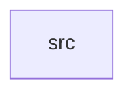

_Generated by CodeAtlas._

## Details

Owns 0 symbols across 1 file(s).

### src

Owns 1152 symbols across 46 file(s).

**Related Classes/Methods:** _None_

**Source Files:**

- `crates/server/src/ai.rs`
  - `crates.server.src.ai.AIConfig`
  - `crates.server.src.ai.AIEngine`
  - `crates.server.src.ai.AIEngine.call_api`
  - `crates.server.src.ai.AIEngine.claude_call_api`
  - `crates.server.src.ai.AIEngine.claude_complete`
  - `crates.server.src.ai.AIEngine.claude_explain`
  - `crates.server.src.ai.AIEngine.claude_fix`
  - `crates.server.src.ai.AIEngine.claude_nl_to_sql`
  - `crates.server.src.ai.AIEngine.claude_request`
  - `crates.server.src.ai.AIEngine.complete_code`
  - `crates.server.src.ai.AIEngine.config`
  - `crates.server.src.ai.AIEngine.explain`
  - `crates.server.src.ai.AIEngine.fix_error`
  - `crates.server.src.ai.AIEngine.get_mcp_tools`
  - `crates.server.src.ai.AIEngine.new`
  - `crates.server.src.ai.AIEngine.nl_to_sql`
  - `crates.server.src.ai.AIEngine.ollama_call_api`
  - `crates.server.src.ai.AIEngine.ollama_complete`
  - `crates.server.src.ai.AIEngine.ollama_explain`
  - `crates.server.src.ai.AIEngine.ollama_fix`
  - `crates.server.src.ai.AIEngine.ollama_nl_to_sql`
  - `crates.server.src.ai.AIEngine.ollama_request`
  - `crates.server.src.ai.AIEngine.openai_call_api`
  - `crates.server.src.ai.AIEngine.openai_complete`
  - `crates.server.src.ai.AIEngine.openai_explain`
  - `crates.server.src.ai.AIEngine.openai_fix`
  - `crates.server.src.ai.AIEngine.openai_nl_to_sql`
  - `crates.server.src.ai.AIEngine.openai_request`
  - `crates.server.src.ai.AIEngine.transform`
  - `crates.server.src.ai.AIRequest`
  - `crates.server.src.ai.AIResponse`
  - `crates.server.src.ai.strip_code_fences`
- `crates/server/src/ai_training.rs`
  - `crates.server.src.ai_training.AIProvider`
  - `crates.server.src.ai_training.AITrainingManager`
  - `crates.server.src.ai_training.AITrainingManager.add_training_log`
  - `crates.server.src.ai_training.AITrainingManager.cancel_job`
  - `crates.server.src.ai_training.AITrainingManager.create_fine_tuning_job`
  - `crates.server.src.ai_training.AITrainingManager.default`
  - `crates.server.src.ai_training.AITrainingManager.delete_endpoint`
  - `crates.server.src.ai_training.AITrainingManager.deploy_endpoint`
  - `crates.server.src.ai_training.AITrainingManager.estimate_training_cost`
  - `crates.server.src.ai_training.AITrainingManager.get_checkpoint`
  - `crates.server.src.ai_training.AITrainingManager.get_endpoint`
  - `crates.server.src.ai_training.AITrainingManager.get_job`
  - `crates.server.src.ai_training.AITrainingManager.get_runpod_instances`
  - `crates.server.src.ai_training.AITrainingManager.launch_runpod_instance`
  - `crates.server.src.ai_training.AITrainingManager.list_checkpoints`
  - `crates.server.src.ai_training.AITrainingManager.list_endpoints`
  - `crates.server.src.ai_training.AITrainingManager.list_jobs`
  - `crates.server.src.ai_training.AITrainingManager.new`
  - `crates.server.src.ai_training.AITrainingManager.runpod_graphql`
  - `crates.server.src.ai_training.AITrainingManager.save_checkpoint`
  - `crates.server.src.ai_training.AITrainingManager.start_job`
  - `crates.server.src.ai_training.AITrainingManager.stop_runpod_instance`
  - `crates.server.src.ai_training.AITrainingManager.update_metrics`
  - `crates.server.src.ai_training.AITrainingManager.with_runpod_url`
  - `crates.server.src.ai_training.ComputeProvider`
  - `crates.server.src.ai_training.FineTuningConfig`
  - `crates.server.src.ai_training.InferenceEndpoint`
  - `crates.server.src.ai_training.ModelCheckpoint`
  - `crates.server.src.ai_training.RunPodInstance`
  - `crates.server.src.ai_training.TrainingJob`
  - `crates.server.src.ai_training.TrainingLog`
  - `crates.server.src.ai_training.TrainingMetrics`
  - `crates.server.src.ai_training.TrainingStatus`
  - `crates.server.src.ai_training.tests.deploy_endpoint_creates_a_real_runpod_serverless_endpoint`
  - `crates.server.src.ai_training.tests.deploy_endpoint_requires_an_existing_checkpoint`
  - `crates.server.src.ai_training.tests.get_runpod_instances_parses_realistic_myself_response`
  - `crates.server.src.ai_training.tests.launch_runpod_instance_extracts_pod_id`
  - `crates.server.src.ai_training.tests.launch_runpod_instance_surfaces_graphql_errors`
  - `crates.server.src.ai_training.tests.runpod_calls_fail_fast_without_an_api_key`
  - `crates.server.src.ai_training.tests.stop_runpod_instance_sends_pod_stop_mutation`
  - `crates.server.src.ai_training.tests.test_checkpoint_management`
  - `crates.server.src.ai_training.tests.test_config`
  - `crates.server.src.ai_training.tests.test_create_fine_tuning_job`
  - `crates.server.src.ai_training.tests.test_validate_config`
- `crates/server/src/airflow_integration.rs`
  - `crates.server.src.airflow_integration.AirflowDag`
  - `crates.server.src.airflow_integration.AirflowManager`
  - `crates.server.src.airflow_integration.AirflowManager.create_dag`
  - `crates.server.src.airflow_integration.AirflowManager.generate_docker_compose_airflow`
  - `crates.server.src.airflow_integration.AirflowManager.generate_python_dag`
  - `crates.server.src.airflow_integration.AirflowManager.get_dag_run_status`
  - `crates.server.src.airflow_integration.AirflowManager.list_dags`
  - `crates.server.src.airflow_integration.AirflowManager.list_tasks`
  - `crates.server.src.airflow_integration.AirflowManager.new`
  - `crates.server.src.airflow_integration.AirflowManager.request`
  - `crates.server.src.airflow_integration.AirflowManager.trigger_dag`
  - `crates.server.src.airflow_integration.AirflowManager.with_dags_folder`
  - `crates.server.src.airflow_integration.AirflowTask`
  - `crates.server.src.airflow_integration.DagRun`
  - `crates.server.src.airflow_integration.TaskInstance`
  - `crates.server.src.airflow_integration.parse_dag_run`
  - `crates.server.src.airflow_integration.parse_dags`
  - `crates.server.src.airflow_integration.parse_tasks`
  - `crates.server.src.airflow_integration.schedule_interval_string`
  - `crates.server.src.airflow_integration.string_array`
  - `crates.server.src.airflow_integration.tests.create_dag_with_dags_folder_writes_a_real_python_file`
  - `crates.server.src.airflow_integration.tests.create_dag_without_dags_folder_is_a_clear_error_not_a_fake_success`
  - `crates.server.src.airflow_integration.tests.get_dag_run_status_computes_duration_from_start_and_end`
  - `crates.server.src.airflow_integration.tests.http_error_status_is_surfaced_not_silently_swallowed`
  - `crates.server.src.airflow_integration.tests.list_dags_handles_plain_string_schedule_interval`
  - `crates.server.src.airflow_integration.tests.list_dags_parses_a_realistic_airflow_response`
  - `crates.server.src.airflow_integration.tests.list_tasks_extracts_class_name_and_dependencies`
  - `crates.server.src.airflow_integration.tests.manager`
  - `crates.server.src.airflow_integration.tests.trigger_dag_parses_run_id_and_state`
- `crates/server/src/api.rs`
  - `crates.server.src.api.AIChatRequest`
  - `crates.server.src.api.AIConfigDetail`
  - `crates.server.src.api.AIConfigRequest`
  - `crates.server.src.api.AIConfigResponse`
  - `crates.server.src.api.AIEditRequest`
  - `crates.server.src.api.AIResponseData`
  - `crates.server.src.api.AddCloudStorageRequest`
  - `crates.server.src.api.AddGroupMemberRequest`
  - `crates.server.src.api.AddRillTileRequest`
  - `crates.server.src.api.AuditLogsResponse`
  - `crates.server.src.api.AuditQueryRequest`
  - `crates.server.src.api.AuthResponse`
  - `crates.server.src.api.AuthenticatedResponse`
  - `crates.server.src.api.AutocompleteRequest`
  - `crates.server.src.api.BuildExecutionPlanRequest`
  - `crates.server.src.api.ChatMessage`
  - `crates.server.src.api.CreateCloudWarehouseConnectionRequest`
  - `crates.server.src.api.CreateContainerRequest`
  - `crates.server.src.api.CreateFineTuningJobRequest`
  - `crates.server.src.api.CreateGroupRequest`
  - `crates.server.src.api.CreateJobRequest`
  - `crates.server.src.api.CreateNotebookRequest`
  - `crates.server.src.api.CreateRillDashboardRequest`
  - `crates.server.src.api.CreateRillProjectRequest`
  - `crates.server.src.api.CreateSparkSessionRequest`
  - `crates.server.src.api.CsrfTokenResponse`
  - `crates.server.src.api.DataPreviewRequest`
  - `crates.server.src.api.DatabaseList`
  - `crates.server.src.api.DisplaySettingsRequest`
  - `crates.server.src.api.ExecuteInContainerRequest`
  - `crates.server.src.api.ExecuteSQLRequest`
  - `crates.server.src.api.ExecuteSQLResponse`
  - `crates.server.src.api.ExecuteSandboxRequest`
  - `crates.server.src.api.FileUploadRequest`
  - `crates.server.src.api.FsEntryReq`
  - `crates.server.src.api.FsMoveReq`
  - `crates.server.src.api.FsPathReq`
  - `crates.server.src.api.FsQuery`
  - `crates.server.src.api.FsRenameReq`
  - `crates.server.src.api.FsUploadReq`
  - `crates.server.src.api.FsWriteReq`
  - `crates.server.src.api.GitCloneReq`
  - `crates.server.src.api.GitHubAuthRequest`
  - `crates.server.src.api.GitOpReq`
  - `crates.server.src.api.GoogleOAuthRequest`
  - `crates.server.src.api.GoogleTokenPayload`
  - `crates.server.src.api.GovernanceRequest`
  - `crates.server.src.api.GroupInfo`
  - `crates.server.src.api.JoinCollaborationRequest`
  - `crates.server.src.api.LineageRequest`
  - `crates.server.src.api.LoginRequest`
  - `crates.server.src.api.LogoutRequest`
  - `crates.server.src.api.LogoutResponse`
  - `crates.server.src.api.Magic`
  - `crates.server.src.api.NotebookAccessInfo`
  - `crates.server.src.api.NotebookList`
  - `crates.server.src.api.PiiDetectionRequest`
  - `crates.server.src.api.QualityAssertionRequest`
  - `crates.server.src.api.QueryCodeRequest`
  - `crates.server.src.api.RegisterRequest`
  - `crates.server.src.api.RegisterTableRequest`
  - `crates.server.src.api.SaveQueryRequest`
  - `crates.server.src.api.SearchRequest`
  - `crates.server.src.api.SearchResponse`
  - `crates.server.src.api.SessionInfo`
  - `crates.server.src.api.ShareNotebookRequest`
  - `crates.server.src.api.TerminalRequest`
  - `crates.server.src.api.UpdateCatalogRequest`
  - `crates.server.src.api.UpdateNotebookRequest`
  - `crates.server.src.api.User`
  - `crates.server.src.api.UserResponse`
  - `crates.server.src.api.WriteContainerFileRequest`
  - `crates.server.src.api.ZoomRequest`
  - `crates.server.src.api.add_cloud_storage`
  - `crates.server.src.api.add_group_member`
  - `crates.server.src.api.add_lineage`
  - `crates.server.src.api.add_rill_tile`
  - `crates.server.src.api.ai_chat`
  - `crates.server.src.api.ai_complete`
  - `crates.server.src.api.ai_edit`
  - `crates.server.src.api.ai_explain`
  - `crates.server.src.api.ai_fix`
  - `crates.server.src.api.auth_google`
  - `crates.server.src.api.auth_login`
  - `crates.server.src.api.auth_register`
  - `crates.server.src.api.build_execution_plan`
  - `crates.server.src.api.build_explore_code`
  - `crates.server.src.api.cancel_fine_tuning_job`
  - `crates.server.src.api.cleanup_audit_logs`
  - `crates.server.src.api.clear_cache`
  - `crates.server.src.api.configure_github`
  - `crates.server.src.api.copy_recursive`
  - `crates.server.src.api.create_cloud_warehouse_connection`
  - `crates.server.src.api.create_database`
  - `crates.server.src.api.create_docker_container`
  - `crates.server.src.api.create_fine_tuning_job`
  - `crates.server.src.api.create_group`
  - `crates.server.src.api.create_job`
  - `crates.server.src.api.create_notebook`
  - `crates.server.src.api.create_quality_assertion`
  - `crates.server.src.api.create_rill_dashboard`
  - `crates.server.src.api.create_rill_project`
  - `crates.server.src.api.create_spark_session`
  - `crates.server.src.api.databases_path`
  - `crates.server.src.api.db_query_code`
  - `crates.server.src.api.db_query_py`
  - `crates.server.src.api.default_dir`
  - `crates.server.src.api.default_github_branch`
  - `crates.server.src.api.default_sandbox_language`
  - `crates.server.src.api.delete_database`
  - `crates.server.src.api.delete_file`
  - `crates.server.src.api.delete_inference_endpoint`
  - `crates.server.src.api.delete_job`
  - `crates.server.src.api.delete_notebook`
  - `crates.server.src.api.delete_notebook_secure`
  - `crates.server.src.api.delete_saved_query`
  - `crates.server.src.api.deploy_artifacts`
  - `crates.server.src.api.deploy_inference_endpoint`
  - `crates.server.src.api.deploy_to_k8s`
  - `crates.server.src.api.dest_in`
  - `crates.server.src.api.detect_batch_pii`
  - `crates.server.src.api.detect_pii`
  - `crates.server.src.api.download_file`
  - `crates.server.src.api.embed_rill_dashboard`
  - `crates.server.src.api.estimate_cloud_query_cost`
  - `crates.server.src.api.estimate_column_width_bytes`
  - `crates.server.src.api.estimate_table_size_bytes`
  - `crates.server.src.api.execute_cell`
  - `crates.server.src.api.execute_cell_secure`
  - `crates.server.src.api.execute_cloud_warehouse_query`
  - `crates.server.src.api.execute_code_in_container`
  - `crates.server.src.api.execute_database_query`
  - `crates.server.src.api.execute_job_cells`
  - `crates.server.src.api.execute_sandboxed_code`
  - `crates.server.src.api.execute_sql`
  - `crates.server.src.api.execute_sql_cell`
  - `crates.server.src.api.explore_aggregate`
  - `crates.server.src.api.explore_describe`
  - `crates.server.src.api.explore_dispatch`
  - `crates.server.src.api.explore_export_code`
  - `crates.server.src.api.explore_lineage`
  - `crates.server.src.api.explore_overview`
  - `crates.server.src.api.explore_page`
  - `crates.server.src.api.explore_profile`
  - `crates.server.src.api.explore_schema`
  - `crates.server.src.api.export_rill_project`
  - `crates.server.src.api.first_github_repo`
  - `crates.server.src.api.format_code`
  - `crates.server.src.api.fs_copy`
  - `crates.server.src.api.fs_delete`
  - `crates.server.src.api.fs_list`
  - `crates.server.src.api.fs_mkdir`
  - `crates.server.src.api.fs_move`
  - `crates.server.src.api.fs_new_file`
  - `crates.server.src.api.fs_ok`
  - `crates.server.src.api.fs_read`
  - `crates.server.src.api.fs_rename`
  - `crates.server.src.api.fs_upload`
  - `crates.server.src.api.fs_write`
  - `crates.server.src.api.fullscreen_output`
  - `crates.server.src.api.generate_airflow_dag`
  - `crates.server.src.api.get_active_collaborators`
  - `crates.server.src.api.get_ai_config`
  - `crates.server.src.api.get_airflow_dag_status`
  - `crates.server.src.api.get_audit_stats`
  - `crates.server.src.api.get_cache_stats`
  - `crates.server.src.api.get_cell_execution_history`
  - `crates.server.src.api.get_cloud_warehouse_databases`
  - `crates.server.src.api.get_cloud_warehouse_tables`
  - `crates.server.src.api.get_column_statistics`
  - `crates.server.src.api.get_container_files`
  - `crates.server.src.api.get_container_logs`
  - `crates.server.src.api.get_container_stats`
  - `crates.server.src.api.get_csrf_token`
  - `crates.server.src.api.get_data_preview_with_stats`
  - `crates.server.src.api.get_dbt_project_yml`
  - `crates.server.src.api.get_display_settings`
  - `crates.server.src.api.get_docker_compose`
  - `crates.server.src.api.get_execution_statistics`
  - `crates.server.src.api.get_favorite_queries`
  - `crates.server.src.api.get_fine_tuning_job`
  - `crates.server.src.api.get_group_members`
  - `crates.server.src.api.get_ignored_libraries`
  - `crates.server.src.api.get_job`
  - `crates.server.src.api.get_k8s_manifest`
  - `crates.server.src.api.get_k8s_pods`
  - `crates.server.src.api.get_lineage`
  - `crates.server.src.api.get_mac_compatible_fonts`
  - `crates.server.src.api.get_me`
  - `crates.server.src.api.get_notebook`
  - `crates.server.src.api.get_notebook_execution_stats`
  - `crates.server.src.api.get_notebook_secure`
  - `crates.server.src.api.get_pii_columns`
  - `crates.server.src.api.get_quality_score`
  - `crates.server.src.api.get_query_optimizations`
  - `crates.server.src.api.get_rill_project`
  - `crates.server.src.api.get_runpod_instances`
  - `crates.server.src.api.get_spark_session`
  - `crates.server.src.api.git`
  - `crates.server.src.api.git_clone`
  - `crates.server.src.api.git_commit`
  - `crates.server.src.api.git_init`
  - `crates.server.src.api.git_json`
  - `crates.server.src.api.git_pull`
  - `crates.server.src.api.git_push`
  - `crates.server.src.api.git_status`
  - `crates.server.src.api.github_status`
  - `crates.server.src.api.ignore_library`
  - `crates.server.src.api.job_airflow_dag`
  - `crates.server.src.api.join_collaboration`
  - `crates.server.src.api.js`
  - `crates.server.src.api.kernel_interrupt`
  - `crates.server.src.api.kernel_restart`
  - `crates.server.src.api.kernel_variables`
  - `crates.server.src.api.list_accessible_notebooks`
  - `crates.server.src.api.list_airflow_dags`
  - `crates.server.src.api.list_catalog`
  - `crates.server.src.api.list_cloud_storage`
  - `crates.server.src.api.list_cloud_warehouse_connections`
  - `crates.server.src.api.list_databases`
  - `crates.server.src.api.list_dbt_models`
  - `crates.server.src.api.list_docker_containers`
  - `crates.server.src.api.list_files`
  - `crates.server.src.api.list_fine_tuning_jobs`
  - `crates.server.src.api.list_groups`
  - `crates.server.src.api.list_inference_endpoints`
  - `crates.server.src.api.list_jobs`
  - `crates.server.src.api.list_model_checkpoints`
  - `crates.server.src.api.list_notebooks`
  - `crates.server.src.api.list_notebooks_authenticated`
  - `crates.server.src.api.list_rill_projects`
  - `crates.server.src.api.list_saved_queries`
  - `crates.server.src.api.list_sessions`
  - `crates.server.src.api.list_spark_sessions`
  - `crates.server.src.api.load_databases`
  - `crates.server.src.api.load_warehouses`
  - `crates.server.src.api.logout`
  - `crates.server.src.api.parse_magic`
  - `crates.server.src.api.pipe_python`
  - `crates.server.src.api.post_comment`
  - `crates.server.src.api.pull_docker_image`
  - `crates.server.src.api.pull_from_github`
  - `crates.server.src.api.push_to_github`
  - `crates.server.src.api.query_audit_logs`
  - `crates.server.src.api.query_via_kernel`
  - `crates.server.src.api.read_container_file`
  - `crates.server.src.api.read_notebook_or_error`
  - `crates.server.src.api.register_table`
  - `crates.server.src.api.remove_cloud_storage`
  - `crates.server.src.api.remove_docker_container`
  - `crates.server.src.api.remove_group_member`
  - `crates.server.src.api.reset_output_zoom`
  - `crates.server.src.api.revoke_notebook_access`
  - `crates.server.src.api.revoke_session_endpoint`
  - `crates.server.src.api.run_dbt_models`
  - `crates.server.src.api.run_dbt_tests`
  - `crates.server.src.api.run_due_jobs`
  - `crates.server.src.api.run_formatter`
  - `crates.server.src.api.run_job`
  - `crates.server.src.api.run_job_by_name`
  - `crates.server.src.api.run_job_now`
  - `crates.server.src.api.run_quality_checks`
  - `crates.server.src.api.run_shell_cell`
  - `crates.server.src.api.sandbox_availability`
  - `crates.server.src.api.save_databases`
  - `crates.server.src.api.save_query`
  - `crates.server.src.api.save_warehouses`
  - `crates.server.src.api.schedule_due`
  - `crates.server.src.api.search_catalog`
  - `crates.server.src.api.search_notebooks`
  - `crates.server.src.api.search_saved_queries`
  - `crates.server.src.api.set_ai_config`
  - `crates.server.src.api.set_governance`
  - `crates.server.src.api.set_output_zoom`
  - `crates.server.src.api.share_notebook`
  - `crates.server.src.api.sql_complete`
  - `crates.server.src.api.start_docker_container`
  - `crates.server.src.api.start_fine_tuning_job`
  - `crates.server.src.api.stop_docker_container`
  - `crates.server.src.api.suggest_libraries`
  - `crates.server.src.api.sync_with_github`
  - `crates.server.src.api.table_size_estimate_tests.column`
  - `crates.server.src.api.table_size_estimate_tests.estimates_size_from_row_count_and_column_widths`
  - `crates.server.src.api.table_size_estimate_tests.width_lookup_is_case_insensitive`
  - `crates.server.src.api.table_size_estimate_tests.zero_rows_or_no_columns_is_zero_not_a_fabricated_number`
  - `crates.server.src.api.terminal_exec`
  - `crates.server.src.api.test_cloud_warehouse_connection`
  - `crates.server.src.api.test_database`
  - `crates.server.src.api.to_cell_code`
  - `crates.server.src.api.toggle_query_favorite`
  - `crates.server.src.api.trigger_airflow_dag`
  - `crates.server.src.api.update_display_settings`
  - `crates.server.src.api.update_notebook`
  - `crates.server.src.api.update_notebook_secure`
  - `crates.server.src.api.upload_file`
  - `crates.server.src.api.value_to_output`
  - `crates.server.src.api.warehouse_query_code`
  - `crates.server.src.api.warehouse_query_py`
  - `crates.server.src.api.warehouses_path`
  - `crates.server.src.api.write_container_file`
- `crates/server/src/audit.rs`
  - `crates.server.src.audit.AuditEvent`
  - `crates.server.src.audit.AuditEvent.new`
  - `crates.server.src.audit.AuditEvent.with_details`
  - `crates.server.src.audit.AuditEvent.with_error`
  - `crates.server.src.audit.AuditEvent.with_ip_address`
  - `crates.server.src.audit.AuditEvent.with_resource`
  - `crates.server.src.audit.AuditEvent.with_result`
  - `crates.server.src.audit.AuditEvent.with_user_agent`
  - `crates.server.src.audit.cleanup_old_logs`
  - `crates.server.src.audit.log_event`
  - `crates.server.src.audit.query_logs`
  - `crates.server.src.audit.tests.test_audit_event_builder`
  - `crates.server.src.audit.tests.test_audit_event_with_error`
- `crates/server/src/cache.rs`
  - `crates.server.src.cache.CacheStats`
  - `crates.server.src.cache.CachedResult`
  - `crates.server.src.cache.CachedResult.is_expired`
  - `crates.server.src.cache.QueryCache`
  - `crates.server.src.cache.QueryCache.cleanup_if_needed`
  - `crates.server.src.cache.QueryCache.clear`
  - `crates.server.src.cache.QueryCache.get`
  - `crates.server.src.cache.QueryCache.hash_query`
  - `crates.server.src.cache.QueryCache.invalidate`
  - `crates.server.src.cache.QueryCache.new`
  - `crates.server.src.cache.QueryCache.put`
  - `crates.server.src.cache.QueryCache.stats`
  - `crates.server.src.cache.tests.test_cache_expiration`
  - `crates.server.src.cache.tests.test_cache_hash_consistency`
  - `crates.server.src.cache.tests.test_cache_invalidate`
  - `crates.server.src.cache.tests.test_cache_put_get`
  - `crates.server.src.cache.tests.test_cache_stats`
- `crates/server/src/catalog.rs`
  - `crates.server.src.catalog.CatalogEntry`
  - `crates.server.src.catalog.ColumnMetadata`
  - `crates.server.src.catalog.ColumnStats`
  - `crates.server.src.catalog.DataCatalog`
  - `crates.server.src.catalog.DataCatalog.add_tags`
  - `crates.server.src.catalog.DataCatalog.get_all_tags`
  - `crates.server.src.catalog.DataCatalog.get_entry`
  - `crates.server.src.catalog.DataCatalog.list_by_notebook`
  - `crates.server.src.catalog.DataCatalog.new`
  - `crates.server.src.catalog.DataCatalog.register_table`
  - `crates.server.src.catalog.DataCatalog.remove_tag`
  - `crates.server.src.catalog.DataCatalog.search_by_column`
  - `crates.server.src.catalog.DataCatalog.search_by_name`
  - `crates.server.src.catalog.DataCatalog.update_description`
  - `crates.server.src.catalog.TableMetadata`
- `crates/server/src/cell_executor.rs`
  - `crates.server.src.cell_executor.CellExecutor`
  - `crates.server.src.cell_executor.CellExecutor.execute_code`
  - `crates.server.src.cell_executor.CellExecutor.execute_with_timeout`
  - `crates.server.src.cell_executor.CellExecutor.get_timeout`
  - `crates.server.src.cell_executor.CellExecutor.new`
  - `crates.server.src.cell_executor.CellExecutor.set_max_output_size`
  - `crates.server.src.cell_executor.CellExecutor.set_timeout`
  - `crates.server.src.cell_executor.CellExecutor.truncate_output`
  - `crates.server.src.cell_executor.CellExecutor.validate_code`
  - `crates.server.src.cell_executor.CellExecutor.with_timeout`
- `crates/server/src/cloud_storage.rs`
  - `crates.server.src.cloud_storage.AzureBlobClient`
  - `crates.server.src.cloud_storage.AzureBlobClient.account_key`
  - `crates.server.src.cloud_storage.AzureBlobClient.authorization_header`
  - `crates.server.src.cloud_storage.AzureBlobClient.base_url`
  - `crates.server.src.cloud_storage.AzureBlobClient.delete`
  - `crates.server.src.cloud_storage.AzureBlobClient.download`
  - `crates.server.src.cloud_storage.AzureBlobClient.list`
  - `crates.server.src.cloud_storage.AzureBlobClient.new`
  - `crates.server.src.cloud_storage.AzureBlobClient.rfc1123_now`
  - `crates.server.src.cloud_storage.AzureBlobClient.upload`
  - `crates.server.src.cloud_storage.AzureBlobClient.with_endpoint_override`
  - `crates.server.src.cloud_storage.CloudStorageConfig`
  - `crates.server.src.cloud_storage.CloudStorageCredentials`
  - `crates.server.src.cloud_storage.CloudStorageFile`
  - `crates.server.src.cloud_storage.CloudStorageManager`
  - `crates.server.src.cloud_storage.CloudStorageManager.add_storage`
  - `crates.server.src.cloud_storage.CloudStorageManager.default`
  - `crates.server.src.cloud_storage.CloudStorageManager.new`
  - `crates.server.src.cloud_storage.CloudStorageManager.remove_storage`
  - `crates.server.src.cloud_storage.CloudStorageProvider`
  - `crates.server.src.cloud_storage.GCSClient`
  - `crates.server.src.cloud_storage.GCSClient.access_token`
  - `crates.server.src.cloud_storage.GCSClient.access_token.Claims`
  - `crates.server.src.cloud_storage.GCSClient.delete`
  - `crates.server.src.cloud_storage.GCSClient.download`
  - `crates.server.src.cloud_storage.GCSClient.list`
  - `crates.server.src.cloud_storage.GCSClient.new`
  - `crates.server.src.cloud_storage.GCSClient.upload`
  - `crates.server.src.cloud_storage.GCSClient.with_base_urls`
  - `crates.server.src.cloud_storage.GoogleDriveClient`
  - `crates.server.src.cloud_storage.GoogleDriveClient.access_token`
  - `crates.server.src.cloud_storage.GoogleDriveClient.list`
  - `crates.server.src.cloud_storage.GoogleDriveClient.mount`
  - `crates.server.src.cloud_storage.GoogleDriveClient.new`
  - `crates.server.src.cloud_storage.GoogleDriveClient.unmount`
  - `crates.server.src.cloud_storage.GoogleDriveClient.upload`
  - `crates.server.src.cloud_storage.GoogleDriveClient.with_base_urls`
  - `crates.server.src.cloud_storage.S3Client`
  - `crates.server.src.cloud_storage.S3Client.base_url`
  - `crates.server.src.cloud_storage.S3Client.creds`
  - `crates.server.src.cloud_storage.S3Client.delete`
  - `crates.server.src.cloud_storage.S3Client.download`
  - `crates.server.src.cloud_storage.S3Client.host`
  - `crates.server.src.cloud_storage.S3Client.list`
  - `crates.server.src.cloud_storage.S3Client.new`
  - `crates.server.src.cloud_storage.S3Client.signed_request`
  - `crates.server.src.cloud_storage.S3Client.upload`
  - `crates.server.src.cloud_storage.S3Client.with_endpoint_override`
  - `crates.server.src.cloud_storage.parse_azure_list_response`
  - `crates.server.src.cloud_storage.parse_connection_string`
  - `crates.server.src.cloud_storage.parse_s3_list_response`
  - `crates.server.src.cloud_storage.tests.azure_download_404_is_a_clear_not_found_error`
  - `crates.server.src.cloud_storage.tests.azure_list_parses_realistic_blob_list_xml`
  - `crates.server.src.cloud_storage.tests.azure_upload_sends_shared_key_signed_put`
  - `crates.server.src.cloud_storage.tests.gcs_list_parses_items`
  - `crates.server.src.cloud_storage.tests.gcs_oauth_failure_surfaces_clear_error`
  - `crates.server.src.cloud_storage.tests.gcs_upload_exchanges_jwt_for_token_then_uploads`
  - `crates.server.src.cloud_storage.tests.gdrive_mount_fails_when_token_refresh_is_rejected`
  - `crates.server.src.cloud_storage.tests.gdrive_mount_verifies_credentials_via_about_endpoint`
  - `crates.server.src.cloud_storage.tests.gdrive_unmount_is_a_documented_noop`
  - `crates.server.src.cloud_storage.tests.gdrive_upload_sends_multipart_with_metadata_and_content`
  - `crates.server.src.cloud_storage.tests.missing_account_key_is_a_clear_error`
  - `crates.server.src.cloud_storage.tests.parses_account_name_and_key_from_connection_string`
  - `crates.server.src.cloud_storage.tests.s3_delete_succeeds_on_204`
  - `crates.server.src.cloud_storage.tests.s3_download_404_is_a_clear_not_found_error`
  - `crates.server.src.cloud_storage.tests.s3_download_returns_body_bytes`
  - `crates.server.src.cloud_storage.tests.s3_list_parses_realistic_list_objects_v2_xml`
  - `crates.server.src.cloud_storage.tests.s3_upload_sends_signed_put_with_body_and_content_type`
  - `crates.server.src.cloud_storage.tests.test_azure`
  - `crates.server.src.cloud_storage.tests.test_gcs`
  - `crates.server.src.cloud_storage.tests.test_gdrive`
  - `crates.server.src.cloud_storage.tests.test_s3`
  - `crates.server.src.cloud_storage.unescape_xml`
  - `crates.server.src.cloud_storage.xml_blocks`
  - `crates.server.src.cloud_storage.xml_field`
- `crates/server/src/connection_manager.rs`
  - `crates.server.src.connection_manager.ConnectionHealthCheck`
  - `crates.server.src.connection_manager.ConnectionManager`
  - `crates.server.src.connection_manager.ConnectionManager.check_connection_health`
  - `crates.server.src.connection_manager.ConnectionManager.get_all_connections`
  - `crates.server.src.connection_manager.ConnectionManager.get_connection`
  - `crates.server.src.connection_manager.ConnectionManager.get_connections_by_type`
  - `crates.server.src.connection_manager.ConnectionManager.get_connections_overview`
  - `crates.server.src.connection_manager.ConnectionManager.new`
  - `crates.server.src.connection_manager.ConnectionManager.register_connection`
  - `crates.server.src.connection_manager.ConnectionManager.remove_connection`
  - `crates.server.src.connection_manager.ConnectionManager.update_connection_stats`
  - `crates.server.src.connection_manager.ConnectionManager.update_connection_status`
  - `crates.server.src.connection_manager.ConnectionStats`
  - `crates.server.src.connection_manager.ConnectionStatus`
  - `crates.server.src.connection_manager.ConnectionType`
  - `crates.server.src.connection_manager.ConnectionsOverview`
  - `crates.server.src.connection_manager.ExternalConnection`
- `crates/server/src/data_profiler.rs`
  - `crates.server.src.data_profiler.ColumnProfile`
  - `crates.server.src.data_profiler.ColumnStats`
  - `crates.server.src.data_profiler.DataFrameProfile`
  - `crates.server.src.data_profiler.DataProfiler`
  - `crates.server.src.data_profiler.DataProfiler.calculate_stats`
  - `crates.server.src.data_profiler.DataProfiler.detect_quality_issues`
  - `crates.server.src.data_profiler.DataProfiler.estimate_memory`
  - `crates.server.src.data_profiler.DataProfiler.infer_type`
  - `crates.server.src.data_profiler.DataProfiler.profile_dataframe`
  - `crates.server.src.data_profiler.DataQualityIssue`
  - `crates.server.src.data_profiler.MissingDataPattern`
- `crates/server/src/dbt_integration.rs`
  - `crates.server.src.dbt_integration.DbtColumn`
  - `crates.server.src.dbt_integration.DbtManager`
  - `crates.server.src.dbt_integration.DbtManager.cmd`
  - `crates.server.src.dbt_integration.DbtManager.dbt_available`
  - `crates.server.src.dbt_integration.DbtManager.generate_dbt_project_yml`
  - `crates.server.src.dbt_integration.DbtManager.generate_docs`
  - `crates.server.src.dbt_integration.DbtManager.generate_profiles_yml`
  - `crates.server.src.dbt_integration.DbtManager.get_lineage`
  - `crates.server.src.dbt_integration.DbtManager.list_models`
  - `crates.server.src.dbt_integration.DbtManager.manifest_path`
  - `crates.server.src.dbt_integration.DbtManager.new`
  - `crates.server.src.dbt_integration.DbtManager.run`
  - `crates.server.src.dbt_integration.DbtManager.run_dbt`
  - `crates.server.src.dbt_integration.DbtManager.run_results_path`
  - `crates.server.src.dbt_integration.DbtManager.run_tests`
  - `crates.server.src.dbt_integration.DbtModel`
  - `crates.server.src.dbt_integration.DbtProject`
  - `crates.server.src.dbt_integration.DbtRunResult`
  - `crates.server.src.dbt_integration.DbtTest`
  - `crates.server.src.dbt_integration.ParsedRunResults`
  - `crates.server.src.dbt_integration.RunResultRow`
  - `crates.server.src.dbt_integration.TestMeta`
  - `crates.server.src.dbt_integration.normalize_test_status`
  - `crates.server.src.dbt_integration.parse_lineage`
  - `crates.server.src.dbt_integration.parse_models_from_manifest`
  - `crates.server.src.dbt_integration.parse_run_results`
  - `crates.server.src.dbt_integration.parse_test_metadata`
  - `crates.server.src.dbt_integration.tests.builds_lineage_graph_for_downstream_model`
  - `crates.server.src.dbt_integration.tests.builds_lineage_graph_for_upstream_model`
  - `crates.server.src.dbt_integration.tests.dbt_not_installed_produces_clear_error`
  - `crates.server.src.dbt_integration.tests.fixture_manifest`
  - `crates.server.src.dbt_integration.tests.fixture_run_results`
  - `crates.server.src.dbt_integration.tests.lineage_errors_on_unknown_model`
  - `crates.server.src.dbt_integration.tests.parses_models_and_links_column_tests`
  - `crates.server.src.dbt_integration.tests.parses_run_results_with_elapsed_time`
  - `crates.server.src.dbt_integration.tests.parses_test_metadata_linking_model_and_type`
  - `crates.server.src.dbt_integration.tests.rejects_malformed_manifest`
  - `crates.server.src.dbt_integration.tests.test_project`
- `crates/server/src/display_settings.rs`
  - `crates.server.src.display_settings.DisplaySettings`
  - `crates.server.src.display_settings.DisplaySettings.default`
  - `crates.server.src.display_settings.DisplaySettingsManager`
  - `crates.server.src.display_settings.DisplaySettingsManager.export_settings`
  - `crates.server.src.display_settings.DisplaySettingsManager.get_settings`
  - `crates.server.src.display_settings.DisplaySettingsManager.import_settings`
  - `crates.server.src.display_settings.DisplaySettingsManager.new`
  - `crates.server.src.display_settings.DisplaySettingsManager.reset_settings`
  - `crates.server.src.display_settings.DisplaySettingsManager.save_settings`
  - `crates.server.src.display_settings.DisplaySettingsManager.update_settings`
  - `crates.server.src.display_settings.DisplaySettingsUpdate`
- `crates/server/src/docker_executor.rs`
  - `crates.server.src.docker_executor.ContainerCellExecutor`
  - `crates.server.src.docker_executor.ContainerCellExecutor.execute_file_in_container`
  - `crates.server.src.docker_executor.ContainerCellExecutor.execute_python_in_container`
  - `crates.server.src.docker_executor.ContainerCellExecutor.execute_shell_in_container`
  - `crates.server.src.docker_executor.ContainerFile`
  - `crates.server.src.docker_executor.DockerContainer`
  - `crates.server.src.docker_executor.DockerExecutor`
  - `crates.server.src.docker_executor.DockerExecutor.cmd`
  - `crates.server.src.docker_executor.DockerExecutor.copy_from_container`
  - `crates.server.src.docker_executor.DockerExecutor.copy_to_container`
  - `crates.server.src.docker_executor.DockerExecutor.create_container`
  - `crates.server.src.docker_executor.DockerExecutor.docker_available`
  - `crates.server.src.docker_executor.DockerExecutor.execute_in_container`
  - `crates.server.src.docker_executor.DockerExecutor.execute_sandboxed`
  - `crates.server.src.docker_executor.DockerExecutor.get_container_files`
  - `crates.server.src.docker_executor.DockerExecutor.get_container_logs`
  - `crates.server.src.docker_executor.DockerExecutor.get_container_stats`
  - `crates.server.src.docker_executor.DockerExecutor.list_containers`
  - `crates.server.src.docker_executor.DockerExecutor.new`
  - `crates.server.src.docker_executor.DockerExecutor.pull_image`
  - `crates.server.src.docker_executor.DockerExecutor.read_container_file`
  - `crates.server.src.docker_executor.DockerExecutor.remove_container`
  - `crates.server.src.docker_executor.DockerExecutor.run`
  - `crates.server.src.docker_executor.DockerExecutor.start_container`
  - `crates.server.src.docker_executor.DockerExecutor.stop_container`
  - `crates.server.src.docker_executor.DockerExecutor.write_container_file`
  - `crates.server.src.docker_executor.DockerStats`
  - `crates.server.src.docker_executor.ExecutionResult`
  - `crates.server.src.docker_executor.PythonContainerCell`
  - `crates.server.src.docker_executor.SandboxOptions`
  - `crates.server.src.docker_executor.SandboxOptions.default`
  - `crates.server.src.docker_executor.default_cpus`
  - `crates.server.src.docker_executor.default_image`
  - `crates.server.src.docker_executor.default_memory_mb`
  - `crates.server.src.docker_executor.default_pids_limit`
  - `crates.server.src.docker_executor.default_timeout_secs`
  - `crates.server.src.docker_executor.parse_bytes`
  - `crates.server.src.docker_executor.parse_io_pair`
  - `crates.server.src.docker_executor.parse_mem_usage`
  - `crates.server.src.docker_executor.tests.sandbox_captures_nonzero_exit_and_stderr`
  - `crates.server.src.docker_executor.tests.sandbox_enforces_memory_limit`
  - `crates.server.src.docker_executor.tests.sandbox_enforces_wall_clock_timeout_and_kills_container`
  - `crates.server.src.docker_executor.tests.sandbox_executes_python_and_returns_real_stdout`
  - `crates.server.src.docker_executor.tests.sandbox_executes_shell_and_returns_real_stdout`
  - `crates.server.src.docker_executor.tests.sandbox_has_no_network_access_by_default`
  - `crates.server.src.docker_executor.tests.test_parse_bytes`
  - `crates.server.src.docker_executor.tests.test_parse_mem_usage`
  - `crates.server.src.docker_executor.tests.test_sandbox_options_defaults`
- `crates/server/src/enterprise_auth.rs`
  - `crates.server.src.enterprise_auth.AADConfig`
  - `crates.server.src.enterprise_auth.AuditLog`
  - `crates.server.src.enterprise_auth.AuthProvider`
  - `crates.server.src.enterprise_auth.AuthSession`
  - `crates.server.src.enterprise_auth.AuthenticatedUser`
  - `crates.server.src.enterprise_auth.EnterpriseAuthManager`
  - `crates.server.src.enterprise_auth.EnterpriseAuthManager.audit_log`
  - `crates.server.src.enterprise_auth.EnterpriseAuthManager.authenticate_with_aad`
  - `crates.server.src.enterprise_auth.EnterpriseAuthManager.authenticate_with_ldap`
  - `crates.server.src.enterprise_auth.EnterpriseAuthManager.authenticate_with_oauth`
  - `crates.server.src.enterprise_auth.EnterpriseAuthManager.check_permission`
  - `crates.server.src.enterprise_auth.EnterpriseAuthManager.create_session`
  - `crates.server.src.enterprise_auth.EnterpriseAuthManager.create_tenant`
  - `crates.server.src.enterprise_auth.EnterpriseAuthManager.default`
  - `crates.server.src.enterprise_auth.EnterpriseAuthManager.generate_jwt`
  - `crates.server.src.enterprise_auth.EnterpriseAuthManager.get_audit_logs`
  - `crates.server.src.enterprise_auth.EnterpriseAuthManager.get_tenant`
  - `crates.server.src.enterprise_auth.EnterpriseAuthManager.list_tenants`
  - `crates.server.src.enterprise_auth.EnterpriseAuthManager.new`
  - `crates.server.src.enterprise_auth.EnterpriseAuthManager.revoke_session`
  - `crates.server.src.enterprise_auth.EnterpriseAuthManager.setup_aad`
  - `crates.server.src.enterprise_auth.EnterpriseAuthManager.setup_ldap`
  - `crates.server.src.enterprise_auth.EnterpriseAuthManager.setup_oauth`
  - `crates.server.src.enterprise_auth.EnterpriseAuthManager.setup_saml`
  - `crates.server.src.enterprise_auth.EnterpriseAuthManager.validate_jwt`
  - `crates.server.src.enterprise_auth.EnterpriseAuthManager.validate_session`
  - `crates.server.src.enterprise_auth.JWTClaims`
  - `crates.server.src.enterprise_auth.JWTToken`
  - `crates.server.src.enterprise_auth.LDAPConfig`
  - `crates.server.src.enterprise_auth.OAuthConfig`
  - `crates.server.src.enterprise_auth.SAMLConfig`
  - `crates.server.src.enterprise_auth.TenantConfig`
  - `crates.server.src.enterprise_auth.UserRole`
  - `crates.server.src.enterprise_auth.tests.test_aad_setup`
  - `crates.server.src.enterprise_auth.tests.test_audit_logging`
  - `crates.server.src.enterprise_auth.tests.test_session_management`
  - `crates.server.src.enterprise_auth.tests.test_tenant_management`
- `crates/server/src/execution.rs`
  - `crates.server.src.execution.ExecutionRecord`
  - `crates.server.src.execution.ExecutionRecord.new`
  - `crates.server.src.execution.ExecutionRecord.with_code_preview`
  - `crates.server.src.execution.ExecutionRecord.with_duration`
  - `crates.server.src.execution.ExecutionRecord.with_error`
  - `crates.server.src.execution.ExecutionRecord.with_memory`
  - `crates.server.src.execution.ExecutionRecord.with_rows`
  - `crates.server.src.execution.ExecutionRecord.with_status`
  - `crates.server.src.execution.ExecutionStats`
  - `crates.server.src.execution.ExecutionStatus`
  - `crates.server.src.execution.ExecutionStatus.as_str`
  - `crates.server.src.execution.get_cell_history`
  - `crates.server.src.execution.get_notebook_stats`
  - `crates.server.src.execution.record_execution`
  - `crates.server.src.execution.tests.test_execution_record_builder`
  - `crates.server.src.execution.tests.test_execution_with_error`
- `crates/server/src/execution_pipeline.rs`
  - `crates.server.src.execution_pipeline.CellId`
  - `crates.server.src.execution_pipeline.CellNode`
  - `crates.server.src.execution_pipeline.CellType`
  - `crates.server.src.execution_pipeline.ExecutionPipeline`
  - `crates.server.src.execution_pipeline.ExecutionPipeline.analyze_dependencies`
  - `crates.server.src.execution_pipeline.ExecutionPipeline.build_plan`
  - `crates.server.src.execution_pipeline.ExecutionPipeline.can_skip_cell_execution`
  - `crates.server.src.execution_pipeline.ExecutionPipeline.default`
  - `crates.server.src.execution_pipeline.ExecutionPipeline.dfs_visit`
  - `crates.server.src.execution_pipeline.ExecutionPipeline.get_execution_plan`
  - `crates.server.src.execution_pipeline.ExecutionPipeline.get_execution_statistics`
  - `crates.server.src.execution_pipeline.ExecutionPipeline.get_next_executable`
  - `crates.server.src.execution_pipeline.ExecutionPipeline.new`
  - `crates.server.src.execution_pipeline.ExecutionPipeline.record_execution`
  - `crates.server.src.execution_pipeline.ExecutionPipeline.topological_sort`
  - `crates.server.src.execution_pipeline.ExecutionPlan`
  - `crates.server.src.execution_pipeline.ExecutionResult`
  - `crates.server.src.execution_pipeline.ExecutionStatistics`
  - `crates.server.src.execution_pipeline.ExecutionStatus`
  - `crates.server.src.execution_pipeline.tests.test_circular_dependency_detection`
  - `crates.server.src.execution_pipeline.tests.test_topological_sort`
- `crates/server/src/file_formats.rs`
  - `crates.server.src.file_formats.DeltaColumnInfo`
  - `crates.server.src.file_formats.DeltaLakeMetadata`
  - `crates.server.src.file_formats.FileFormat`
  - `crates.server.src.file_formats.FileFormatInfo`
  - `crates.server.src.file_formats.FileFormatManager`
  - `crates.server.src.file_formats.FileFormatManager.get_format_info`
  - `crates.server.src.file_formats.FileFormatManager.get_recommended_format`
  - `crates.server.src.file_formats.FileFormatManager.list_all_formats`
  - `crates.server.src.file_formats.FileFormatManager.read_delta_metadata`
  - `crates.server.src.file_formats.FileFormatManager.read_orc_metadata`
  - `crates.server.src.file_formats.FileFormatManager.read_parquet_metadata`
  - `crates.server.src.file_formats.ORCColumnInfo`
  - `crates.server.src.file_formats.ORCMetadata`
  - `crates.server.src.file_formats.ParquetColumnInfo`
  - `crates.server.src.file_formats.ParquetMetadata`
- `crates/server/src/file_manager.rs`
  - `crates.server.src.file_manager.CloudStorageManager`
  - `crates.server.src.file_manager.CloudStorageManager.get_mount`
  - `crates.server.src.file_manager.CloudStorageManager.list_mounts`
  - `crates.server.src.file_manager.CloudStorageManager.load_mounts`
  - `crates.server.src.file_manager.CloudStorageManager.mount_cloud_storage`
  - `crates.server.src.file_manager.CloudStorageManager.new`
  - `crates.server.src.file_manager.CloudStorageManager.save_mount`
  - `crates.server.src.file_manager.CloudStorageManager.unmount_storage`
  - `crates.server.src.file_manager.CloudStorageMount`
  - `crates.server.src.file_manager.CloudStorageMountRequest`
  - `crates.server.src.file_manager.FileManager`
  - `crates.server.src.file_manager.FileManager.delete_file`
  - `crates.server.src.file_manager.FileManager.download_file`
  - `crates.server.src.file_manager.FileManager.list_files`
  - `crates.server.src.file_manager.FileManager.new`
  - `crates.server.src.file_manager.FileManager.upload_file`
  - `crates.server.src.file_manager.FileMetadata`
  - `crates.server.src.file_manager.UploadProgress`
- `crates/server/src/files.rs`
  - `crates.server.src.files.from_ipynb`
  - `crates.server.src.files.to_ipynb`
- `crates/server/src/github_integration.rs`
  - `crates.server.src.github_integration.BackupConfig`
  - `crates.server.src.github_integration.GitHubIntegration`
  - `crates.server.src.github_integration.GitHubManager`
  - `crates.server.src.github_integration.GitHubManager.add_repository`
  - `crates.server.src.github_integration.GitHubManager.authed_request`
  - `crates.server.src.github_integration.GitHubManager.backup_all`
  - `crates.server.src.github_integration.GitHubManager.contents_url`
  - `crates.server.src.github_integration.GitHubManager.get_file_contents`
  - `crates.server.src.github_integration.GitHubManager.list_repositories`
  - `crates.server.src.github_integration.GitHubManager.new`
  - `crates.server.src.github_integration.GitHubManager.new_with_base_url`
  - `crates.server.src.github_integration.GitHubManager.pull_notebook`
  - `crates.server.src.github_integration.GitHubManager.push_notebook`
  - `crates.server.src.github_integration.GitHubManager.require_token`
  - `crates.server.src.github_integration.GitHubManager.sync_notebook`
  - `crates.server.src.github_integration.GitHubRepository`
  - `crates.server.src.github_integration.tests.backup_all_requires_at_least_one_repository`
  - `crates.server.src.github_integration.tests.contents_url_handles_empty_repo_path`
  - `crates.server.src.github_integration.tests.contents_url_joins_path_and_notebook_name`
  - `crates.server.src.github_integration.tests.pull_notebook_decodes_base64_content_from_real_response`
  - `crates.server.src.github_integration.tests.pull_notebook_reports_missing_file_on_404`
  - `crates.server.src.github_integration.tests.push_notebook_creates_new_file_without_sha_on_404`
  - `crates.server.src.github_integration.tests.push_notebook_includes_existing_sha_when_updating`
  - `crates.server.src.github_integration.tests.push_notebook_surfaces_github_error_body_on_failure`
  - `crates.server.src.github_integration.tests.push_pull_sync_without_token_fail_fast`
  - `crates.server.src.github_integration.tests.sync_notebook_reports_already_in_sync_when_content_matches`
  - `crates.server.src.github_integration.tests.test_repo`
- `crates/server/src/governance.rs`
  - `crates.server.src.governance.ColumnGovernance`
  - `crates.server.src.governance.GovernanceManager`
  - `crates.server.src.governance.GovernanceManager.add_governance_tag`
  - `crates.server.src.governance.GovernanceManager.add_pii_tag`
  - `crates.server.src.governance.GovernanceManager.add_policy`
  - `crates.server.src.governance.GovernanceManager.add_quality_assertion`
  - `crates.server.src.governance.GovernanceManager.check_compliance`
  - `crates.server.src.governance.GovernanceManager.default`
  - `crates.server.src.governance.GovernanceManager.get_column_governance`
  - `crates.server.src.governance.GovernanceManager.get_columns_by_sensitivity`
  - `crates.server.src.governance.GovernanceManager.get_pii_columns`
  - `crates.server.src.governance.GovernanceManager.get_policy`
  - `crates.server.src.governance.GovernanceManager.new`
  - `crates.server.src.governance.GovernanceManager.set_column_governance`
  - `crates.server.src.governance.GovernanceManager.set_sensitivity`
  - `crates.server.src.governance.GovernancePolicy`
  - `crates.server.src.governance.GovernanceTag`
  - `crates.server.src.governance.PiiCategory`
  - `crates.server.src.governance.PolicyRule`
  - `crates.server.src.governance.PolicyViolation`
  - `crates.server.src.governance.QualityAssertion`
  - `crates.server.src.governance.SensitivityLevel`
- `crates/server/src/iceberg_engine.rs`
  - `crates.server.src.iceberg_engine.IcebergColumn`
  - `crates.server.src.iceberg_engine.IcebergConfig`
  - `crates.server.src.iceberg_engine.IcebergEngine`
  - `crates.server.src.iceberg_engine.IcebergEngine.compact_table`
  - `crates.server.src.iceberg_engine.IcebergEngine.create_table`
  - `crates.server.src.iceberg_engine.IcebergEngine.delete_old_snapshots`
  - `crates.server.src.iceberg_engine.IcebergEngine.get_config`
  - `crates.server.src.iceberg_engine.IcebergEngine.get_manifest_entries`
  - `crates.server.src.iceberg_engine.IcebergEngine.get_stats`
  - `crates.server.src.iceberg_engine.IcebergEngine.get_table_snapshots`
  - `crates.server.src.iceberg_engine.IcebergEngine.list_tables`
  - `crates.server.src.iceberg_engine.IcebergEngine.new`
  - `crates.server.src.iceberg_engine.IcebergEngine.read_table`
  - `crates.server.src.iceberg_engine.IcebergEngine.time_travel`
  - `crates.server.src.iceberg_engine.IcebergEngine.write_to_table`
  - `crates.server.src.iceberg_engine.IcebergSnapshot`
  - `crates.server.src.iceberg_engine.IcebergStats`
  - `crates.server.src.iceberg_engine.IcebergTable`
  - `crates.server.src.iceberg_engine.ManifestEntry`
  - `crates.server.src.iceberg_engine.SnapshotSummary`
- `crates/server/src/jobs.rs`
  - `crates.server.src.jobs.Job`
  - `crates.server.src.jobs.JobRun`
  - `crates.server.src.jobs.Schedule`
  - `crates.server.src.jobs.Schedule.default`
  - `crates.server.src.jobs.jobs_path`
  - `crates.server.src.jobs.load_jobs`
  - `crates.server.src.jobs.save_jobs`
- `crates/server/src/k8s_deployment.rs`
  - `crates.server.src.k8s_deployment.DockerConfig`
  - `crates.server.src.k8s_deployment.DockerManager`
  - `crates.server.src.k8s_deployment.DockerManager.generate_docker_compose`
  - `crates.server.src.k8s_deployment.DockerManager.generate_dockerfile`
  - `crates.server.src.k8s_deployment.DockerManager.new`
  - `crates.server.src.k8s_deployment.EnvVar`
  - `crates.server.src.k8s_deployment.KubernetesConfig`
  - `crates.server.src.k8s_deployment.KubernetesManager`
  - `crates.server.src.k8s_deployment.KubernetesManager.context_args`
  - `crates.server.src.k8s_deployment.KubernetesManager.deploy`
  - `crates.server.src.k8s_deployment.KubernetesManager.generate_manifest`
  - `crates.server.src.k8s_deployment.KubernetesManager.get_pod_status`
  - `crates.server.src.k8s_deployment.KubernetesManager.kubectl_available`
  - `crates.server.src.k8s_deployment.KubernetesManager.new`
  - `crates.server.src.k8s_deployment.KubernetesManager.pod_resource_usage`
  - `crates.server.src.k8s_deployment.KubernetesManager.run`
  - `crates.server.src.k8s_deployment.KubernetesManager.run_with_stdin`
  - `crates.server.src.k8s_deployment.KubernetesManager.scale_replicas`
  - `crates.server.src.k8s_deployment.PodStatus`
  - `crates.server.src.k8s_deployment.VolumeMount`
  - `crates.server.src.k8s_deployment.pods_from_kubectl_json`
  - `crates.server.src.k8s_deployment.tests.context_args_empty_when_cluster_name_unset`
  - `crates.server.src.k8s_deployment.tests.context_args_included_when_cluster_name_set`
  - `crates.server.src.k8s_deployment.tests.deploy_against_a_real_cluster_applies_the_generated_manifest`
  - `crates.server.src.k8s_deployment.tests.empty_items_list_returns_empty_pods`
  - `crates.server.src.k8s_deployment.tests.fixture_pods_json`
  - `crates.server.src.k8s_deployment.tests.kubectl_not_available_produces_a_clear_error_not_a_panic`
  - `crates.server.src.k8s_deployment.tests.malformed_json_is_a_clear_error_not_a_panic`
  - `crates.server.src.k8s_deployment.tests.parses_pod_status_ready_and_restart_count_from_real_kubectl_shape`
  - `crates.server.src.k8s_deployment.tests.test_config`
- `crates/server/src/kernel.rs`
  - `crates.server.src.kernel.KernelHandle`
  - `crates.server.src.kernel.KernelManager`
  - `crates.server.src.kernel.KernelManager.build_outputs`
  - `crates.server.src.kernel.KernelManager.drop`
  - `crates.server.src.kernel.KernelManager.execute`
  - `crates.server.src.kernel.KernelManager.execute_internal`
  - `crates.server.src.kernel.KernelManager.execute_streaming`
  - `crates.server.src.kernel.KernelManager.execution_count`
  - `crates.server.src.kernel.KernelManager.explore`
  - `crates.server.src.kernel.KernelManager.handle_package_install`
  - `crates.server.src.kernel.KernelManager.inspect`
  - `crates.server.src.kernel.KernelManager.kernel_id`
  - `crates.server.src.kernel.KernelManager.new`
  - `crates.server.src.kernel.KernelManager.pid_handle`
  - `crates.server.src.kernel.KernelManager.restart`
  - `crates.server.src.kernel.KernelManager.set_timeout`
  - `crates.server.src.kernel.KernelManager.spawn_process`
  - `crates.server.src.kernel.KernelRegistry`
  - `crates.server.src.kernel.KernelRegistry.default`
  - `crates.server.src.kernel.KernelRegistry.get`
  - `crates.server.src.kernel.KernelRegistry.get_or_spawn`
  - `crates.server.src.kernel.KernelRegistry.new`
  - `crates.server.src.kernel.python_binary`
  - `crates.server.src.kernel.tests.different_keys_get_independent_kernels_with_isolated_namespaces`
  - `crates.server.src.kernel.tests.python_binary_resolves_to_a_real_runnable_interpreter`
- `crates/server/src/library_advisor.rs`
  - `crates.server.src.library_advisor.IgnoreLibraryRequest`
  - `crates.server.src.library_advisor.IgnoredLibrary`
  - `crates.server.src.library_advisor.LibraryAdvisor`
  - `crates.server.src.library_advisor.LibraryAdvisor.new`
  - `crates.server.src.library_advisor.LibraryAdvisor.suggest_libraries`
  - `crates.server.src.library_advisor.LibrarySuggestion`
  - `crates.server.src.library_advisor.SuggestLibrariesRequest`
  - `crates.server.src.library_advisor.SuggestionsResponse`
- `crates/server/src/lineage.rs`
  - `crates.server.src.lineage.ColumnLineage`
  - `crates.server.src.lineage.ColumnRef`
  - `crates.server.src.lineage.LineageEdge`
  - `crates.server.src.lineage.LineageGraph`
  - `crates.server.src.lineage.LineageGraph.add_edge`
  - `crates.server.src.lineage.LineageGraph.default`
  - `crates.server.src.lineage.LineageGraph.find_upstream_chain`
  - `crates.server.src.lineage.LineageGraph.find_upstream_chain.dfs`
  - `crates.server.src.lineage.LineageGraph.get_impact_analysis`
  - `crates.server.src.lineage.LineageGraph.get_impact_analysis.dfs`
  - `crates.server.src.lineage.LineageGraph.get_lineage`
  - `crates.server.src.lineage.LineageGraph.new`
- `crates/server/src/main.rs`
  - `crates.server.src.main.AppState`
  - `crates.server.src.main.Assets`
  - `crates.server.src.main.main`
  - `crates.server.src.main.static_handler`
- `crates/server/src/models.rs`
  - `crates.server.src.models.Cell`
  - `crates.server.src.models.ExecuteCellRequest`
  - `crates.server.src.models.ExecuteCellResponse`
  - `crates.server.src.models.IgnoredLibraryRecord`
  - `crates.server.src.models.Notebook`
  - `crates.server.src.models.NotebookMetadata`
  - `crates.server.src.models.Output`
- `crates/server/src/output_renderer.rs`
  - `crates.server.src.output_renderer.OutputRenderer`
  - `crates.server.src.output_renderer.OutputRenderer.default`
  - `crates.server.src.output_renderer.OutputRenderer.enable_fullscreen`
  - `crates.server.src.output_renderer.OutputRenderer.format_html_output`
  - `crates.server.src.output_renderer.OutputRenderer.format_image_output`
  - `crates.server.src.output_renderer.OutputRenderer.format_table_output`
  - `crates.server.src.output_renderer.OutputRenderer.get_fullscreen_css`
  - `crates.server.src.output_renderer.OutputRenderer.new`
  - `crates.server.src.output_renderer.OutputRenderer.set_zoom`
  - `crates.server.src.output_renderer.OutputViewConfig`
  - `crates.server.src.output_renderer.RenderedOutput`
- `crates/server/src/pii_detector.rs`
  - `crates.server.src.pii_detector.PatternMatcher`
  - `crates.server.src.pii_detector.PiiDetectionResult`
  - `crates.server.src.pii_detector.PiiDetector`
  - `crates.server.src.pii_detector.PiiDetector.default`
  - `crates.server.src.pii_detector.PiiDetector.detect_batch`
  - `crates.server.src.pii_detector.PiiDetector.detect_in_column`
  - `crates.server.src.pii_detector.PiiDetector.new`
  - `crates.server.src.pii_detector.PiiMatch`
  - `crates.server.src.pii_detector.tests.test_email_detection`
  - `crates.server.src.pii_detector.tests.test_ssn_detection`
- `crates/server/src/platform.rs`
  - `crates.server.src.platform.Architecture`
  - `crates.server.src.platform.OS`
  - `crates.server.src.platform.Platform`
  - `crates.server.src.platform.Platform.binary_name`
  - `crates.server.src.platform.Platform.detect`
  - `crates.server.src.platform.Platform.detect_apple_silicon_version`
  - `crates.server.src.platform.Platform.detect_architecture`
  - `crates.server.src.platform.Platform.detect_os`
  - `crates.server.src.platform.Platform.download_url`
  - `crates.server.src.platform.Platform.is_apple_silicon`
  - `crates.server.src.platform.Platform.is_apple_silicon_mac`
  - `crates.server.src.platform.Platform.supported`
  - `crates.server.src.platform.tests.test_apple_silicon_detection`
  - `crates.server.src.platform.tests.test_binary_name_generation`
  - `crates.server.src.platform.tests.test_platform_detection`
- `crates/server/src/quality_assertions.rs`
  - `crates.server.src.quality_assertions.AssertionEngine`
  - `crates.server.src.quality_assertions.AssertionEngine.create_assertion`
  - `crates.server.src.quality_assertions.AssertionEngine.create_freshness_assertion`
  - `crates.server.src.quality_assertions.AssertionEngine.create_not_null_assertion`
  - `crates.server.src.quality_assertions.AssertionEngine.create_pattern_assertion`
  - `crates.server.src.quality_assertions.AssertionEngine.create_positive_assertion`
  - `crates.server.src.quality_assertions.AssertionEngine.create_range_assertion`
  - `crates.server.src.quality_assertions.AssertionEngine.create_unique_assertion`
  - `crates.server.src.quality_assertions.AssertionEngine.parse_assertion_result`
  - `crates.server.src.quality_assertions.AssertionResult`
  - `crates.server.src.quality_assertions.AssertionType`
  - `crates.server.src.quality_assertions.QualityAssertion`
  - `crates.server.src.quality_assertions.QualityReport`
  - `crates.server.src.quality_assertions.QualityReport.calculate_score`
  - `crates.server.src.quality_assertions.tests.error_severity_requires_zero_failures`
  - `crates.server.src.quality_assertions.tests.failure_percentage_uses_the_real_total_count_not_a_hardcoded_one`
  - `crates.server.src.quality_assertions.tests.warning_severity_passes_under_five_percent_failure`
  - `crates.server.src.quality_assertions.tests.zero_total_count_does_not_divide_by_zero`
- `crates/server/src/query_manager.rs`
  - `crates.server.src.query_manager.SavedQuery`
  - `crates.server.src.query_manager.SavedQuery.new`
  - `crates.server.src.query_manager.SavedQuery.with_description`
  - `crates.server.src.query_manager.SavedQuery.with_tags`
  - `crates.server.src.query_manager.delete_query`
  - `crates.server.src.query_manager.get_favorite_queries`
  - `crates.server.src.query_manager.get_user_queries`
  - `crates.server.src.query_manager.record_query_execution`
  - `crates.server.src.query_manager.save_query`
  - `crates.server.src.query_manager.search_queries`
  - `crates.server.src.query_manager.toggle_favorite`
- `crates/server/src/query_validator.rs`
  - `crates.server.src.query_validator.QueryValidator`
  - `crates.server.src.query_validator.QueryValidator.check_blocked_keywords`
  - `crates.server.src.query_validator.QueryValidator.check_comment_injection`
  - `crates.server.src.query_validator.QueryValidator.check_injection_patterns`
  - `crates.server.src.query_validator.QueryValidator.check_nesting_depth`
  - `crates.server.src.query_validator.QueryValidator.strip_comments`
  - `crates.server.src.query_validator.QueryValidator.validate`
  - `crates.server.src.query_validator.tests.test_comment_stripping`
  - `crates.server.src.query_validator.tests.test_injection_or_1_1`
  - `crates.server.src.query_validator.tests.test_max_length`
  - `crates.server.src.query_validator.tests.test_privilege_escalation_always_blocked`
  - `crates.server.src.query_validator.tests.test_sleep_injection`
  - `crates.server.src.query_validator.tests.test_smuggled_stacked_statement_still_blocked`
  - `crates.server.src.query_validator.tests.test_standalone_ddl_dml_is_allowed`
  - `crates.server.src.query_validator.tests.test_valid_select_query`
- `crates/server/src/rbac.rs`
  - `crates.server.src.rbac.AuditLog`
  - `crates.server.src.rbac.NotebookACL`
  - `crates.server.src.rbac.RBACManager`
  - `crates.server.src.rbac.RBACManager.check_permission`
  - `crates.server.src.rbac.RBACManager.get_audit_logs`
  - `crates.server.src.rbac.RBACManager.get_user_role`
  - `crates.server.src.rbac.RBACManager.grant_access`
  - `crates.server.src.rbac.RBACManager.has_permission`
  - `crates.server.src.rbac.RBACManager.initialize_notebook`
  - `crates.server.src.rbac.RBACManager.list_permissions`
  - `crates.server.src.rbac.RBACManager.load_acl`
  - `crates.server.src.rbac.RBACManager.log_audit`
  - `crates.server.src.rbac.RBACManager.new`
  - `crates.server.src.rbac.RBACManager.revoke_access`
  - `crates.server.src.rbac.RBACManager.save_acl`
  - `crates.server.src.rbac.RBACManager.set_public`
  - `crates.server.src.rbac.Role`
  - `crates.server.src.rbac.UserPermission`
- `crates/server/src/realtime_collab.rs`
  - `crates.server.src.realtime_collab.CollabMessage`
  - `crates.server.src.realtime_collab.Comment`
  - `crates.server.src.realtime_collab.Comment.clone`
  - `crates.server.src.realtime_collab.RealtimeManager`
  - `crates.server.src.realtime_collab.RealtimeManager.create_session`
  - `crates.server.src.realtime_collab.RealtimeManager.get_session`
  - `crates.server.src.realtime_collab.RealtimeManager.new`
  - `crates.server.src.realtime_collab.RealtimeManager.remove_session`
  - `crates.server.src.realtime_collab.RealtimeSession`
  - `crates.server.src.realtime_collab.RealtimeSession.add_comment`
  - `crates.server.src.realtime_collab.RealtimeSession.add_user`
  - `crates.server.src.realtime_collab.RealtimeSession.broadcast`
  - `crates.server.src.realtime_collab.RealtimeSession.get_comments`
  - `crates.server.src.realtime_collab.RealtimeSession.get_users`
  - `crates.server.src.realtime_collab.RealtimeSession.new`
  - `crates.server.src.realtime_collab.RealtimeSession.remove_user`
  - `crates.server.src.realtime_collab.RealtimeSession.resolve_comment`
  - `crates.server.src.realtime_collab.UserPresence`
- `crates/server/src/rill_integration.rs`
  - `crates.server.src.rill_integration.AggregationType`
  - `crates.server.src.rill_integration.DataSourceType`
  - `crates.server.src.rill_integration.FilterType`
  - `crates.server.src.rill_integration.MeasureConfig`
  - `crates.server.src.rill_integration.RillConfig`
  - `crates.server.src.rill_integration.RillConfig.default`
  - `crates.server.src.rill_integration.RillDashboard`
  - `crates.server.src.rill_integration.RillDataSource`
  - `crates.server.src.rill_integration.RillFilter`
  - `crates.server.src.rill_integration.RillProject`
  - `crates.server.src.rill_integration.RillProjectManager`
  - `crates.server.src.rill_integration.RillProjectManager.add_dashboard`
  - `crates.server.src.rill_integration.RillProjectManager.add_tile`
  - `crates.server.src.rill_integration.RillProjectManager.create_project`
  - `crates.server.src.rill_integration.RillProjectManager.export_to_rill_format`
  - `crates.server.src.rill_integration.RillProjectManager.generate_rill_config`
  - `crates.server.src.rill_integration.RillProjectManager.get_project`
  - `crates.server.src.rill_integration.RillProjectManager.list_projects_by_notebook`
  - `crates.server.src.rill_integration.RillProjectManager.new`
  - `crates.server.src.rill_integration.RillTile`
  - `crates.server.src.rill_integration.TilePosition`
  - `crates.server.src.rill_integration.VisualizationType`
- `crates/server/src/scheduler.rs`
  - `crates.server.src.scheduler.ExecutionJob`
  - `crates.server.src.scheduler.NotificationConfig`
  - `crates.server.src.scheduler.ScheduleConfig`
  - `crates.server.src.scheduler.SchedulerManager`
  - `crates.server.src.scheduler.SchedulerManager.calculate_next_run`
  - `crates.server.src.scheduler.SchedulerManager.create_schedule`
  - `crates.server.src.scheduler.SchedulerManager.delete_schedule`
  - `crates.server.src.scheduler.SchedulerManager.get_execution_history`
  - `crates.server.src.scheduler.SchedulerManager.get_notifications`
  - `crates.server.src.scheduler.SchedulerManager.get_schedule`
  - `crates.server.src.scheduler.SchedulerManager.list_schedules`
  - `crates.server.src.scheduler.SchedulerManager.load_schedule`
  - `crates.server.src.scheduler.SchedulerManager.new`
  - `crates.server.src.scheduler.SchedulerManager.record_execution`
  - `crates.server.src.scheduler.SchedulerManager.save_execution_job`
  - `crates.server.src.scheduler.SchedulerManager.save_schedule`
  - `crates.server.src.scheduler.SchedulerManager.set_notifications`
  - `crates.server.src.scheduler.SchedulerManager.update_schedule`
  - `crates.server.src.scheduler.SchedulerManager.validate_cron`
- `crates/server/src/search_engine.rs`
  - `crates.server.src.search_engine.SearchCategory`
  - `crates.server.src.search_engine.SearchCategory.fmt`
  - `crates.server.src.search_engine.SearchResult`
  - `crates.server.src.search_engine.SearchableItem`
- `crates/server/src/spark_manager.rs`
  - `crates.server.src.spark_manager.ColumnInfo`
  - `crates.server.src.spark_manager.DAGStage`
  - `crates.server.src.spark_manager.DataFrameInfo`
  - `crates.server.src.spark_manager.ExecutionDAG`
  - `crates.server.src.spark_manager.ShuffleAnalysis`
  - `crates.server.src.spark_manager.SparkConfig`
  - `crates.server.src.spark_manager.SparkManager`
  - `crates.server.src.spark_manager.SparkManager.analyze_shuffle`
  - `crates.server.src.spark_manager.SparkManager.cache_dataframe`
  - `crates.server.src.spark_manager.SparkManager.create_session`
  - `crates.server.src.spark_manager.SparkManager.default`
  - `crates.server.src.spark_manager.SparkManager.get_dag`
  - `crates.server.src.spark_manager.SparkManager.get_dataframe`
  - `crates.server.src.spark_manager.SparkManager.get_session`
  - `crates.server.src.spark_manager.SparkManager.list_dataframes`
  - `crates.server.src.spark_manager.SparkManager.list_sessions`
  - `crates.server.src.spark_manager.SparkManager.new`
  - `crates.server.src.spark_manager.SparkManager.record_dag`
  - `crates.server.src.spark_manager.SparkManager.register_dataframe`
  - `crates.server.src.spark_manager.SparkManager.stop_session`
  - `crates.server.src.spark_manager.SparkSessionInfo`
  - `crates.server.src.spark_manager.tests.test_create_session`
  - `crates.server.src.spark_manager.tests.test_session_lifecycle`
- `crates/server/src/sql_executor.rs`
  - `crates.server.src.sql_executor.QueryOptimization`
  - `crates.server.src.sql_executor.QueryResult`
  - `crates.server.src.sql_executor.SQLExecutor`
  - `crates.server.src.sql_executor.SQLExecutor.analyze_query`
  - `crates.server.src.sql_executor.SQLExecutor.format_result_as_html`
  - `crates.server.src.sql_executor.SQLExecutor.is_sql_cell`
  - `crates.server.src.sql_executor.SQLExecutor.parse_sql_cell`
  - `crates.server.src.sql_executor.escape_html`
  - `crates.server.src.sql_executor.tests.test_query_analysis`
  - `crates.server.src.sql_executor.tests.test_sql_detection`
  - `crates.server.src.sql_executor.tests.test_sql_parsing`
- `crates/server/src/sql_schema.rs`
  - `crates.server.src.sql_schema.ColumnSchema`
  - `crates.server.src.sql_schema.CompletionSuggestion`
  - `crates.server.src.sql_schema.SchemaInfo`
  - `crates.server.src.sql_schema.TableSchema`
  - `crates.server.src.sql_schema.generate_suggestions`
  - `crates.server.src.sql_schema.get_database_schema`
  - `crates.server.src.sql_schema.tests.test_case_insensitive`
  - `crates.server.src.sql_schema.tests.test_function_suggestions`
  - `crates.server.src.sql_schema.tests.test_keyword_suggestions`
  - `crates.server.src.sql_schema.tests.test_suggestions_sorted`
- `crates/server/src/versioning.rs`
  - `crates.server.src.versioning.CellChange`
  - `crates.server.src.versioning.NotebookVersion`
  - `crates.server.src.versioning.VersionDiff`
  - `crates.server.src.versioning.VersionManager`
  - `crates.server.src.versioning.VersionManager.create_branch`
  - `crates.server.src.versioning.VersionManager.create_version`
  - `crates.server.src.versioning.VersionManager.get_version_diff`
  - `crates.server.src.versioning.VersionManager.list_versions`
  - `crates.server.src.versioning.VersionManager.load_metadata`
  - `crates.server.src.versioning.VersionManager.load_version`
  - `crates.server.src.versioning.VersionManager.new`
  - `crates.server.src.versioning.VersionManager.rollback_to_version`
  - `crates.server.src.versioning.VersionManager.switch_branch`
  - `crates.server.src.versioning.VersionMetadata`
- `crates/server/src/ws.rs`
  - `crates.server.src.ws.handle_socket`
  - `crates.server.src.ws.notebook_ws`
