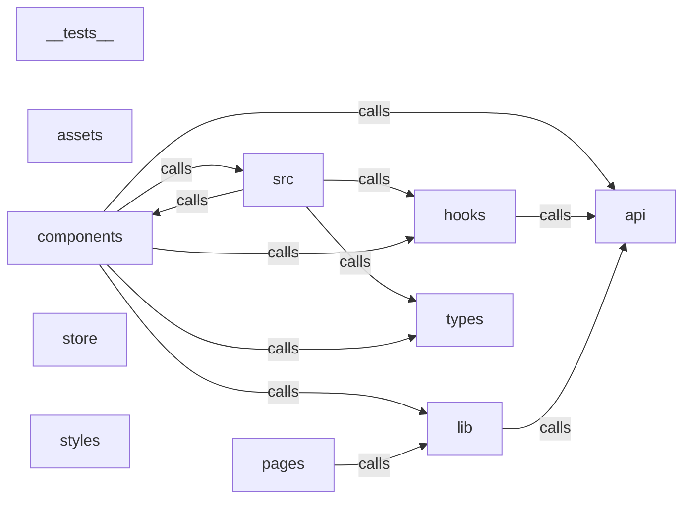

_Generated by CodeAtlas._

## Details

Owns 20 symbols across 6 file(s).

### __tests__

Owns 0 symbols across 3 file(s).

**Related Classes/Methods:** _None_

### api

Owns 93 symbols across 10 file(s).

**Related Classes/Methods:** _None_

**Source Files:**

- `frontend/src/api/ai.ts`
  - `frontend.src.api.ai.AIConfigDetail`
  - `frontend.src.api.ai.AIConfigInput`
  - `frontend.src.api.ai.AIResult`
  - `frontend.src.api.ai.aiChat`
  - `frontend.src.api.ai.aiConfigured`
  - `frontend.src.api.ai.aiEdit`
  - `frontend.src.api.ai.aiExplain`
  - `frontend.src.api.ai.aiFix`
  - `frontend.src.api.ai.getAiConfig`
  - `frontend.src.api.ai.ollamaEndpoint`
  - `frontend.src.api.ai.setAiConfig`
  - `frontend.src.api.ai.validateTavilyKey`
- `frontend/src/api/autocomplete.ts`
  - `frontend.src.api.autocomplete.OLLAMA`
  - `frontend.src.api.autocomplete.SqlCompletionSuggestion`
  - `frontend.src.api.autocomplete.mapCompletionKind`
  - `frontend.src.api.autocomplete.ollamaModel`
  - `frontend.src.api.autocomplete.registerOllamaCompletions`
  - `frontend.src.api.autocomplete.registerSqlCompletions`
- `frontend/src/api/client.ts`
  - `frontend.src.api.client.APIClient`
  - `frontend.src.api.client.APIClient.createNotebook`
  - `frontend.src.api.client.APIClient.deleteNotebook`
  - `frontend.src.api.client.APIClient.executeCell`
  - `frontend.src.api.client.APIClient.fetch`
  - `frontend.src.api.client.APIClient.getCSRFToken`
  - `frontend.src.api.client.APIClient.getMe`
  - `frontend.src.api.client.APIClient.getNotebook`
  - `frontend.src.api.client.APIClient.getToken`
  - `frontend.src.api.client.APIClient.listNotebooks`
  - `frontend.src.api.client.APIClient.login`
  - `frontend.src.api.client.APIClient.logout`
  - `frontend.src.api.client.APIClient.register`
  - `frontend.src.api.client.APIClient.request`
  - `frontend.src.api.client.APIClient.updateNotebook`
  - `frontend.src.api.client.FetchOptions`
- `frontend/src/api/data.ts`
  - `frontend.src.api.data.DatabaseSchema`
  - `frontend.src.api.data.DbConnection`
  - `frontend.src.api.data.QueryResult`
  - `frontend.src.api.data.SchemaTable`
  - `frontend.src.api.data.WarehouseConnection`
  - `frontend.src.api.data.createDatabase`
  - `frontend.src.api.data.deleteDatabase`
  - `frontend.src.api.data.getDatabaseSchema`
  - `frontend.src.api.data.getWarehouseSchema`
  - `frontend.src.api.data.listDatabases`
  - `frontend.src.api.data.listWarehouses`
  - `frontend.src.api.data.queryCode`
  - `frontend.src.api.data.queryDatabase`
  - `frontend.src.api.data.queryWarehouse`
- `frontend/src/api/explore.ts`
  - `frontend.src.api.explore.ColumnSchema`
  - `frontend.src.api.explore.ColumnStat`
  - `frontend.src.api.explore.DescribeResult`
  - `frontend.src.api.explore.Filter`
  - `frontend.src.api.explore.Lineage`
  - `frontend.src.api.explore.Measure`
  - `frontend.src.api.explore.Overview`
  - `frontend.src.api.explore.PageResult`
  - `frontend.src.api.explore.SchemaResult`
  - `frontend.src.api.explore.Sort`
  - `frontend.src.api.explore.exploreAggregate`
  - `frontend.src.api.explore.exploreDescribe`
  - `frontend.src.api.explore.exploreExportCode`
  - `frontend.src.api.explore.exploreLineage`
  - `frontend.src.api.explore.exploreOverview`
  - `frontend.src.api.explore.explorePage`
  - `frontend.src.api.explore.exploreProfile`
  - `frontend.src.api.explore.exploreSchema`
  - `frontend.src.api.explore.post`
- `frontend/src/api/format.ts`
  - `frontend.src.api.format.formatCode`
  - `frontend.src.api.format.formatWhole`
  - `frontend.src.api.format.registerPythonFormatter`
- `frontend/src/api/git.ts`
  - `frontend.src.api.git.GitResult`
  - `frontend.src.api.git.GitStatus`
  - `frontend.src.api.git.gitClone`
  - `frontend.src.api.git.gitCommit`
  - `frontend.src.api.git.gitInit`
  - `frontend.src.api.git.gitPull`
  - `frontend.src.api.git.gitPush`
  - `frontend.src.api.git.gitStatus`
- `frontend/src/api/jobs.ts`
  - `frontend.src.api.jobs.JobRun`
  - `frontend.src.api.jobs.JobSummary`
  - `frontend.src.api.jobs.Schedule`
  - `frontend.src.api.jobs.airflowDag`
  - `frontend.src.api.jobs.createJob`
  - `frontend.src.api.jobs.deleteJob`
  - `frontend.src.api.jobs.getJob`
  - `frontend.src.api.jobs.listJobs`
  - `frontend.src.api.jobs.runJob`
- `frontend/src/api/kernel.ts`
  - `frontend.src.api.kernel.KernelVariable`
  - `frontend.src.api.kernel.interruptKernel`
  - `frontend.src.api.kernel.listVariables`
  - `frontend.src.api.kernel.restartKernel`
- `frontend/src/api/stream.ts`
  - `frontend.src.api.stream.ensure`
  - `frontend.src.api.stream.subscribeCellStream`

### assets

Owns 0 symbols across 3 file(s).

**Related Classes/Methods:** _None_

### components

Owns 397 symbols across 57 file(s).

**Related Classes/Methods:** _None_

**Source Files:**

- `frontend/src/components/AIAssistant.tsx`
  - `frontend.src.components.AIAssistant.AIAssistant`
  - `frontend.src.components.AIAssistant.AIAssistantProps`
  - `frontend.src.components.AIAssistant.Message`
  - `frontend.src.components.AIAssistant.copyToClipboard`
- `frontend/src/components/AgentPanel.tsx`
  - `frontend.src.components.AgentPanel.AgentAction`
  - `frontend.src.components.AgentPanel.AgentPanel`
  - `frontend.src.components.AgentPanel.Message`
  - `frontend.src.components.AgentPanel.checkOllama`
  - `frontend.src.components.AgentPanel.loadConfig`
  - `frontend.src.components.AgentPanel.notebookContext`
  - `frontend.src.components.AgentPanel.parseActions`
  - `frontend.src.components.AgentPanel.rejectAction`
  - `frontend.src.components.AgentPanel.runAction`
  - `frontend.src.components.AgentPanel.send`
  - `frontend.src.components.AgentPanel.stripActions`
- `frontend/src/components/AppErrorFallback.tsx`
  - `frontend.src.components.AppErrorFallback.AppErrorFallback`
- `frontend/src/components/BottomPanel.tsx`
  - `frontend.src.components.BottomPanel.BottomPanel`
  - `frontend.src.components.BottomPanel.BottomPanelProps`
  - `frontend.src.components.BottomPanel.loadVariables`
  - `frontend.src.components.BottomPanel.onMove`
  - `frontend.src.components.BottomPanel.onUp`
- `frontend/src/components/Cell.tsx`
  - `frontend.src.components.Cell.CellInner`
  - `frontend.src.components.Cell.CellProps`
  - `frontend.src.components.Cell.acceptProposal`
  - `frontend.src.components.Cell.aiErrorMessage`
  - `frontend.src.components.Cell.errorFromOutputs`
  - `frontend.src.components.Cell.handleRun`
  - `frontend.src.components.Cell.isDark`
  - `frontend.src.components.Cell.notebookContext`
  - `frontend.src.components.Cell.onFont`
  - `frontend.src.components.Cell.onWidget`
  - `frontend.src.components.Cell.openAi`
  - `frontend.src.components.Cell.rejectProposal`
  - `frontend.src.components.Cell.runAiEdit`
  - `frontend.src.components.Cell.runAiExplain`
  - `frontend.src.components.Cell.runAiFix`
- `frontend/src/components/CommandPalette.tsx`
  - `frontend.src.components.CommandPalette.Command`
  - `frontend.src.components.CommandPalette.CommandPalette`
  - `frontend.src.components.CommandPalette.Props`
  - `frontend.src.components.CommandPalette.onKey`
- `frontend/src/components/ConnectionStatus.tsx`
  - `frontend.src.components.ConnectionStatus.Connection`
  - `frontend.src.components.ConnectionStatus.ConnectionStats`
  - `frontend.src.components.ConnectionStatus.ConnectionStatus`
  - `frontend.src.components.ConnectionStatus.ConnectionsOverview`
  - `frontend.src.components.ConnectionStatus.fetchConnections`
  - `frontend.src.components.ConnectionStatus.formatBytes`
  - `frontend.src.components.ConnectionStatus.formatLatency`
  - `frontend.src.components.ConnectionStatus.formatTimeAgo`
  - `frontend.src.components.ConnectionStatus.formatUptime`
  - `frontend.src.components.ConnectionStatus.getStatusIcon`
  - `frontend.src.components.ConnectionStatus.getTypeIcon`
  - `frontend.src.components.ConnectionStatus.refreshConnection`
- `frontend/src/components/DataCatalogPanel.tsx`
  - `frontend.src.components.DataCatalogPanel.CatalogEntry`
  - `frontend.src.components.DataCatalogPanel.ColumnInfo`
  - `frontend.src.components.DataCatalogPanel.DataCatalogPanel`
  - `frontend.src.components.DataCatalogPanel.fetchCatalog`
  - `frontend.src.components.DataCatalogPanel.getPiiIcon`
  - `frontend.src.components.DataCatalogPanel.getSensitivityColor`
  - `frontend.src.components.DataCatalogPanel.handleSearch`
  - `frontend.src.components.DataCatalogPanel.handleSelectEntry`
- `frontend/src/components/DataExplorer.tsx`
  - `frontend.src.components.DataExplorer.CellValue`
  - `frontend.src.components.DataExplorer.ColumnDrawer`
  - `frontend.src.components.DataExplorer.DataExplorer`
  - `frontend.src.components.DataExplorer.ExplorerPicker`
  - `frontend.src.components.DataExplorer.LineageTab`
  - `frontend.src.components.DataExplorer.MetadataTab`
  - `frontend.src.components.DataExplorer.MiniDist`
  - `frontend.src.components.DataExplorer.PreviewGrid`
  - `frontend.src.components.DataExplorer.ProfileBody`
  - `frontend.src.components.DataExplorer.SchemaTab`
  - `frontend.src.components.DataExplorer.Stat`
  - `frontend.src.components.DataExplorer.StatsTab`
  - `frontend.src.components.DataExplorer.StatsTable`
  - `frontend.src.components.DataExplorer.cellText`
  - `frontend.src.components.DataExplorer.currentNotebookId`
  - `frontend.src.components.DataExplorer.downloadCsv`
  - `frontend.src.components.DataExplorer.fmtBytes`
  - `frontend.src.components.DataExplorer.fmtNum`
  - `frontend.src.components.DataExplorer.getSourceType`
  - `frontend.src.components.DataExplorer.insertAsCell`
  - `frontend.src.components.DataExplorer.node`
  - `frontend.src.components.DataExplorer.num`
  - `frontend.src.components.DataExplorer.onKey`
  - `frontend.src.components.DataExplorer.parseFilter`
  - `frontend.src.components.DataExplorer.toggleSort`
  - `frontend.src.components.DataExplorer.typeColor`
  - `frontend.src.components.DataExplorer.typeIcon`
- `frontend/src/components/DataFormats.tsx`
  - `frontend.src.components.DataFormats.DataFormats`
  - `frontend.src.components.DataFormats.FileFormatInfo`
  - `frontend.src.components.DataFormats.IcebergTable`
  - `frontend.src.components.DataFormats.formatBytes`
  - `frontend.src.components.DataFormats.loadFormats`
  - `frontend.src.components.DataFormats.loadIcebergTables`
- `frontend/src/components/DataFrameView.tsx`
  - `frontend.src.components.DataFrameView.Chart`
  - `frontend.src.components.DataFrameView.DataFrameView`
  - `frontend.src.components.DataFrameView.FallbackTable`
  - `frontend.src.components.DataFrameView.isNum`
  - `frontend.src.components.DataFrameView.y`
- `frontend/src/components/DataPanel.tsx`
  - `frontend.src.components.DataPanel.DataPanel`
  - `frontend.src.components.DataPanel.SqlEditor`
  - `frontend.src.components.DataPanel.addDb`
  - `frontend.src.components.DataPanel.fetchSchema`
  - `frontend.src.components.DataPanel.insertAsCell`
  - `frontend.src.components.DataPanel.refresh`
  - `frontend.src.components.DataPanel.registerCompletionProvider`
  - `frontend.src.components.DataPanel.run`
- `frontend/src/components/DatabaseConnector.tsx`
  - `frontend.src.components.DatabaseConnector.DatabaseConnection`
  - `frontend.src.components.DatabaseConnector.DatabaseConnector`
  - `frontend.src.components.DatabaseConnector.handleAddDatabase`
  - `frontend.src.components.DatabaseConnector.handleTestConnection`
- `frontend/src/components/DeployPanel.tsx`
  - `frontend.src.components.DeployPanel.DeployCommands`
  - `frontend.src.components.DeployPanel.DeployPanel`
  - `frontend.src.components.DeployPanel.download`
- `frontend/src/components/DisplaySettings.tsx`
  - `frontend.src.components.DisplaySettings.AccessibilitySettings`
  - `frontend.src.components.DisplaySettings.DisplaySettings`
  - `frontend.src.components.DisplaySettings.DisplaySettingsState`
  - `frontend.src.components.DisplaySettings.EditorSettings`
  - `frontend.src.components.DisplaySettings.NotebookSettings`
  - `frontend.src.components.DisplaySettings.ThemeSettings`
  - `frontend.src.components.DisplaySettings.UILayoutSettings`
  - `frontend.src.components.DisplaySettings.fetchSettings`
  - `frontend.src.components.DisplaySettings.handleChange`
  - `frontend.src.components.DisplaySettings.handleReset`
  - `frontend.src.components.DisplaySettings.handleSave`
- `frontend/src/components/DuckDBExplorer.tsx`
  - `frontend.src.components.DuckDBExplorer.DuckDBExplorer`
  - `frontend.src.components.DuckDBExplorer.QueryResult`
  - `frontend.src.components.DuckDBExplorer.Table`
  - `frontend.src.components.DuckDBExplorer.executeQuery`
  - `frontend.src.components.DuckDBExplorer.exportParquet`
  - `frontend.src.components.DuckDBExplorer.formatBytes`
  - `frontend.src.components.DuckDBExplorer.loadExtensions`
  - `frontend.src.components.DuckDBExplorer.loadParquet`
  - `frontend.src.components.DuckDBExplorer.loadTables`
  - `frontend.src.components.DuckDBExplorer.queryTable`
- `frontend/src/components/EmptyState.tsx`
  - `frontend.src.components.EmptyState.EmptyState`
  - `frontend.src.components.EmptyState.EmptyStateProps`
- `frontend/src/components/ErrorBoundary.tsx`
  - `frontend.src.components.ErrorBoundary.ErrorBoundary`
  - `frontend.src.components.ErrorBoundary.ErrorBoundary.componentDidCatch`
  - `frontend.src.components.ErrorBoundary.ErrorBoundary.constructor`
  - `frontend.src.components.ErrorBoundary.ErrorBoundary.getDerivedStateFromError`
  - `frontend.src.components.ErrorBoundary.ErrorBoundary.handleReset`
  - `frontend.src.components.ErrorBoundary.ErrorBoundary.render`
  - `frontend.src.components.ErrorBoundary.Props`
  - `frontend.src.components.ErrorBoundary.State`
- `frontend/src/components/ErrorCard.tsx`
  - `frontend.src.components.ErrorCard.ErrorCard`
  - `frontend.src.components.ErrorCard.ErrorCardProps`
- `frontend/src/components/ExecutionHistoryPanel.tsx`
  - `frontend.src.components.ExecutionHistoryPanel.ExecutionHistoryPanel`
  - `frontend.src.components.ExecutionHistoryPanel.ExecutionHistoryPanelProps`
  - `frontend.src.components.ExecutionHistoryPanel.ExecutionRecord`
  - `frontend.src.components.ExecutionHistoryPanel.fetchHistory`
  - `frontend.src.components.ExecutionHistoryPanel.formatDate`
  - `frontend.src.components.ExecutionHistoryPanel.formatTime`
  - `frontend.src.components.ExecutionHistoryPanel.getStatusIcon`
- `frontend/src/components/ExecutionMinimap.tsx`
  - `frontend.src.components.ExecutionMinimap.Cell`
  - `frontend.src.components.ExecutionMinimap.ExecutionMinimap`
  - `frontend.src.components.ExecutionMinimap.ExecutionMinimapProps`
- `frontend/src/components/ExecutionMinimapDot.tsx`
  - `frontend.src.components.ExecutionMinimapDot.ExecutionMinimapDot`
  - `frontend.src.components.ExecutionMinimapDot.ExecutionMinimapDotProps`
  - `frontend.src.components.ExecutionMinimapDot.getAriaLabel`
  - `frontend.src.components.ExecutionMinimapDot.getDotColor`
  - `frontend.src.components.ExecutionMinimapDot.handleClick`
- `frontend/src/components/FileExplorer.tsx`
  - `frontend.src.components.FileExplorer.Dir`
  - `frontend.src.components.FileExplorer.FileExplorer`
  - `frontend.src.components.FileExplorer.Loading`
  - `frontend.src.components.FileExplorer.MenuRow`
  - `frontend.src.components.FileExplorer.Node`
  - `frontend.src.components.FileExplorer.Section`
  - `frontend.src.components.FileExplorer.close`
  - `frontend.src.components.FileExplorer.del`
  - `frontend.src.components.FileExplorer.iconFor`
  - `frontend.src.components.FileExplorer.loadIpynb`
  - `frontend.src.components.FileExplorer.newEntry`
  - `frontend.src.components.FileExplorer.openFile`
  - `frontend.src.components.FileExplorer.readDir`
  - `frontend.src.components.FileExplorer.rename`
  - `frontend.src.components.FileExplorer.toggle`
- `frontend/src/components/FileManager.tsx`
  - `frontend.src.components.FileManager.CloudMount`
  - `frontend.src.components.FileManager.CloudStorageMountForm`
  - `frontend.src.components.FileManager.FileItem`
  - `frontend.src.components.FileManager.FileManager`
  - `frontend.src.components.FileManager.formatDate`
  - `frontend.src.components.FileManager.formatFileSize`
  - `frontend.src.components.FileManager.handleDelete`
  - `frontend.src.components.FileManager.handleDownload`
  - `frontend.src.components.FileManager.handleFileSelect`
  - `frontend.src.components.FileManager.handleSubmit`
- `frontend/src/components/FindReplace.tsx`
  - `frontend.src.components.FindReplace.FindReplace`
  - `frontend.src.components.FindReplace.replaceAll`
  - `frontend.src.components.FindReplace.srcOf`
- `frontend/src/components/GitHubSync.tsx`
  - `frontend.src.components.GitHubSync.GitHubConfig`
  - `frontend.src.components.GitHubSync.GitHubSetupForm`
  - `frontend.src.components.GitHubSync.GitHubSetupFormProps`
  - `frontend.src.components.GitHubSync.GitHubSync`
  - `frontend.src.components.GitHubSync.GitHubSyncPanel`
  - `frontend.src.components.GitHubSync.GitHubSyncPanelProps`
  - `frontend.src.components.GitHubSync.SyncStatus`
  - `frontend.src.components.GitHubSync.fetchSyncStatus`
  - `frontend.src.components.GitHubSync.handlePull`
  - `frontend.src.components.GitHubSync.handlePush`
  - `frontend.src.components.GitHubSync.handleSetupGitHub`
  - `frontend.src.components.GitHubSync.handleSubmit`
- `frontend/src/components/GitPanel.tsx`
  - `frontend.src.components.GitPanel.GitPanel`
  - `frontend.src.components.GitPanel.refresh`
  - `frontend.src.components.GitPanel.run`
- `frontend/src/components/JobsPanel.tsx`
  - `frontend.src.components.JobsPanel.JobsPanel`
  - `frontend.src.components.JobsPanel.codeCells`
  - `frontend.src.components.JobsPanel.refresh`
  - `frontend.src.components.JobsPanel.run`
  - `frontend.src.components.JobsPanel.scheduleLabel`
  - `frontend.src.components.JobsPanel.submitCreate`
- `frontend/src/components/KeyboardShortcutsModal.tsx`
  - `frontend.src.components.KeyboardShortcutsModal.KeyboardShortcutsModal`
  - `frontend.src.components.KeyboardShortcutsModal.Shortcut`
- `frontend/src/components/LanguageSelector.tsx`
  - `frontend.src.components.LanguageSelector.LanguageSelector`
  - `frontend.src.components.LanguageSelector.LanguageSelectorProps`
- `frontend/src/components/LayoutControls.tsx`
  - `frontend.src.components.LayoutControls.LayoutControls`
  - `frontend.src.components.LayoutControls.LayoutControlsProps`
- `frontend/src/components/LegendPanel.tsx`
  - `frontend.src.components.LegendPanel.LegendPanel`
  - `frontend.src.components.LegendPanel.LegendPanelProps`
- `frontend/src/components/LibrarySuggester.tsx`
  - `frontend.src.components.LibrarySuggester.LibrarySuggester`
  - `frontend.src.components.LibrarySuggester.LibrarySuggesterProps`
  - `frontend.src.components.LibrarySuggester.LibrarySuggestion`
  - `frontend.src.components.LibrarySuggester.getCategoryIcon`
  - `frontend.src.components.LibrarySuggester.getCategoryLabel`
  - `frontend.src.components.LibrarySuggester.handleIgnore`
- `frontend/src/components/LineageViewer.tsx`
  - `frontend.src.components.LineageViewer.LineageData`
  - `frontend.src.components.LineageViewer.LineageNode`
  - `frontend.src.components.LineageViewer.LineageViewer`
  - `frontend.src.components.LineageViewer.LineageViewerProps`
  - `frontend.src.components.LineageViewer.fetchLineage`
- `frontend/src/components/MenuBar.tsx`
  - `frontend.src.components.MenuBar.MenuBar`
  - `frontend.src.components.MenuBar.MenuBarProps`
  - `frontend.src.components.MenuBar.MenuItem`
  - `frontend.src.components.MenuBar.clearOutputs`
  - `frontend.src.components.MenuBar.close`
  - `frontend.src.components.MenuBar.exportPy`
  - `frontend.src.components.MenuBar.newNotebook`
  - `frontend.src.components.MenuBar.openFile`
  - `frontend.src.components.MenuBar.restartAndRunAll`
  - `frontend.src.components.MenuBar.runAbove`
  - `frontend.src.components.MenuBar.runAll`
  - `frontend.src.components.MenuBar.runBelow`
  - `frontend.src.components.MenuBar.runRange`
  - `frontend.src.components.MenuBar.runSelected`
  - `frontend.src.components.MenuBar.save`
  - `frontend.src.components.MenuBar.srcOf`
- `frontend/src/components/Modal.tsx`
  - `frontend.src.components.Modal.Modal`
  - `frontend.src.components.Modal.ModalProps`
  - `frontend.src.components.Modal.handleEscape`
- `frontend/src/components/Notebook.tsx`
  - `frontend.src.components.Notebook.Inserter`
  - `frontend.src.components.Notebook.Notebook`
  - `frontend.src.components.Notebook.handleZoomChange`
  - `frontend.src.components.Notebook.setFont`
- `frontend/src/components/Output.tsx`
  - `frontend.src.components.Output.ErrorOutput`
  - `frontend.src.components.Output.Output`
  - `frontend.src.components.Output.OutputProps`
  - `frontend.src.components.Output.WidgetControl`
  - `frontend.src.components.Output.asText`
  - `frontend.src.components.Output.fire`
  - `frontend.src.components.Output.isWidgetSpec`
- `frontend/src/components/OutputCard.tsx`
  - `frontend.src.components.OutputCard.OutputCard`
  - `frontend.src.components.OutputCard.OutputCardProps`
  - `frontend.src.components.OutputCard.handleCopy`
- `frontend/src/components/PlotsPanel.tsx`
  - `frontend.src.components.PlotsPanel.PlotsPanel`
- `frontend/src/components/QueryBookmarksPanel.tsx`
  - `frontend.src.components.QueryBookmarksPanel.QueryBookmarksPanel`
  - `frontend.src.components.QueryBookmarksPanel.SavedQuery`
  - `frontend.src.components.QueryBookmarksPanel.copyToClipboard`
  - `frontend.src.components.QueryBookmarksPanel.deleteQuery`
  - `frontend.src.components.QueryBookmarksPanel.fetchQueries`
  - `frontend.src.components.QueryBookmarksPanel.toggleFavorite`
- `frontend/src/components/RelationshipMap.tsx`
  - `frontend.src.components.RelationshipMap.EdgeDetail`
  - `frontend.src.components.RelationshipMap.RelationshipMap`
  - `frontend.src.components.RelationshipMap.RelationshipMapProps`
  - `frontend.src.components.RelationshipMap.applyLayout`
  - `frontend.src.components.RelationshipMap.getCytoscapeStyle`
  - `frontend.src.components.RelationshipMap.handleBackgroundClick`
  - `frontend.src.components.RelationshipMap.handleEdgeClick`
  - `frontend.src.components.RelationshipMap.handleExport`
  - `frontend.src.components.RelationshipMap.handleFitView`
  - `frontend.src.components.RelationshipMap.handleNodeClick`
  - `frontend.src.components.RelationshipMap.handleZoomIn`
  - `frontend.src.components.RelationshipMap.handleZoomOut`
- `frontend/src/components/RillDashboard.tsx`
  - `frontend.src.components.RillDashboard.DashboardViewer`
  - `frontend.src.components.RillDashboard.RillDashboard`
  - `frontend.src.components.RillDashboard.RillDashboardProps`
  - `frontend.src.components.RillDashboard.RillProject`
  - `frontend.src.components.RillDashboard.RillTile`
  - `frontend.src.components.RillDashboard.createDashboard`
  - `frontend.src.components.RillDashboard.createProject`
  - `frontend.src.components.RillDashboard.exportProject`
  - `frontend.src.components.RillDashboard.fetchProjects`
- `frontend/src/components/SchemaExplorer.tsx`
  - `frontend.src.components.SchemaExplorer.SchemaExplorer`
  - `frontend.src.components.SchemaExplorer.SchemaExplorerProps`
  - `frontend.src.components.SchemaExplorer.loadConnections`
  - `frontend.src.components.SchemaExplorer.toggleConnection`
  - `frontend.src.components.SchemaExplorer.toggleTable`
- `frontend/src/components/ServerExplorer.tsx`
  - `frontend.src.components.ServerExplorer.Entry`
  - `frontend.src.components.ServerExplorer.Listing`
  - `frontend.src.components.ServerExplorer.ServerExplorer`
  - `frontend.src.components.ServerExplorer.copy`
  - `frontend.src.components.ServerExplorer.cut`
  - `frontend.src.components.ServerExplorer.delPaths`
  - `frontend.src.components.ServerExplorer.load`
  - `frontend.src.components.ServerExplorer.newFile`
  - `frontend.src.components.ServerExplorer.newFolder`
  - `frontend.src.components.ServerExplorer.onContainerDrop`
  - `frontend.src.components.ServerExplorer.onEntryDragStart`
  - `frontend.src.components.ServerExplorer.onFocus`
  - `frontend.src.components.ServerExplorer.onFolderDrop`
  - `frontend.src.components.ServerExplorer.onRowClick`
  - `frontend.src.components.ServerExplorer.open`
  - `frontend.src.components.ServerExplorer.openNotebook`
  - `frontend.src.components.ServerExplorer.paste`
  - `frontend.src.components.ServerExplorer.reload`
  - `frontend.src.components.ServerExplorer.rename`
  - `frontend.src.components.ServerExplorer.toggleHidden`
  - `frontend.src.components.ServerExplorer.uploadFiles`
- `frontend/src/components/SettingsModal.tsx`
  - `frontend.src.components.SettingsModal.Props`
  - `frontend.src.components.SettingsModal.Row`
  - `frontend.src.components.SettingsModal.Section`
  - `frontend.src.components.SettingsModal.SettingsModal`
  - `frontend.src.components.SettingsModal.Toggle`
  - `frontend.src.components.SettingsModal.onKey`
  - `frontend.src.components.SettingsModal.providerStatus`
  - `frontend.src.components.SettingsModal.saveAi`
  - `frontend.src.components.SettingsModal.saveExecutionSettings`
  - `frontend.src.components.SettingsModal.saveSearchSettings`
  - `frontend.src.components.SettingsModal.toDefaultCellLanguage`
  - `frontend.src.components.SettingsModal.toSearchDepth`
- `frontend/src/components/Sidebar.tsx`
  - `frontend.src.components.Sidebar.Sidebar`
  - `frontend.src.components.Sidebar.SidebarProps`
  - `frontend.src.components.Sidebar.handleCreate`
- `frontend/src/components/SqlConnectionPicker.tsx`
  - `frontend.src.components.SqlConnectionPicker.SqlConnectionPicker`
  - `frontend.src.components.SqlConnectionPicker.SqlConnectionPickerProps`
  - `frontend.src.components.SqlConnectionPicker.loadConnections`
- `frontend/src/components/SqlResultsView.tsx`
  - `frontend.src.components.SqlResultsView.SqlResultsView`
  - `frontend.src.components.SqlResultsView.SqlResultsViewProps`
  - `frontend.src.components.SqlResultsView.escapeCsvValue`
  - `frontend.src.components.SqlResultsView.formatCellValue`
  - `frontend.src.components.SqlResultsView.handleCopyToClipboard`
  - `frontend.src.components.SqlResultsView.handleExportCsv`
  - `frontend.src.components.SqlResultsView.handleExportJson`
  - `frontend.src.components.SqlResultsView.renderCellValue`
- `frontend/src/components/TableMetadataPanel.tsx`
  - `frontend.src.components.TableMetadataPanel.ColumnQuickProfile`
  - `frontend.src.components.TableMetadataPanel.TableMetadataPanel`
  - `frontend.src.components.TableMetadataPanel.TableMetadataPanelProps`
  - `frontend.src.components.TableMetadataPanel.loadPreview`
  - `frontend.src.components.TableMetadataPanel.loadStats`
  - `frontend.src.components.TableMetadataPanel.profileColumn`
- `frontend/src/components/TableOfContents.tsx`
  - `frontend.src.components.TableOfContents.TOCItem`
  - `frontend.src.components.TableOfContents.TableOfContents`
  - `frontend.src.components.TableOfContents.TableOfContentsProps`
  - `frontend.src.components.TableOfContents.parseTOC`
  - `frontend.src.components.TableOfContents.scrollToCell`
- `frontend/src/components/TerminalPane.tsx`
  - `frontend.src.components.TerminalPane.TerminalPane`
  - `frontend.src.components.TerminalPane.TerminalPaneProps`
  - `frontend.src.components.TerminalPane.runCmd`
- `frontend/src/components/TerminalSplitContainer.tsx`
  - `frontend.src.components.TerminalSplitContainer.RenderContext`
  - `frontend.src.components.TerminalSplitContainer.TerminalConfig`
  - `frontend.src.components.TerminalSplitContainer.TerminalSplitContainer`
  - `frontend.src.components.TerminalSplitContainer.TerminalSplitContainerProps`
  - `frontend.src.components.TerminalSplitContainer.closePane`
  - `frontend.src.components.TerminalSplitContainer.generateId`
  - `frontend.src.components.TerminalSplitContainer.handleClose`
  - `frontend.src.components.TerminalSplitContainer.handleHistoryChange`
  - `frontend.src.components.TerminalSplitContainer.handleResize`
  - `frontend.src.components.TerminalSplitContainer.handleSplit`
  - `frontend.src.components.TerminalSplitContainer.renderTerminalTree`
  - `frontend.src.components.TerminalSplitContainer.resizeSplit`
  - `frontend.src.components.TerminalSplitContainer.splitPane`
  - `frontend.src.components.TerminalSplitContainer.updatePaneHistory`
- `frontend/src/components/Toolbar.tsx`
  - `frontend.src.components.Toolbar.Toolbar`
  - `frontend.src.components.Toolbar.commitName`
  - `frontend.src.components.Toolbar.handleExport`
- `frontend/src/components/UnifiedSearch.tsx`
  - `frontend.src.components.UnifiedSearch.SearchFilters`
  - `frontend.src.components.UnifiedSearch.SearchResult`
  - `frontend.src.components.UnifiedSearch.UnifiedSearch`
  - `frontend.src.components.UnifiedSearch.getCategoryIcon`
  - `frontend.src.components.UnifiedSearch.getCategoryLabel`
  - `frontend.src.components.UnifiedSearch.handleKeyDown`
  - `frontend.src.components.UnifiedSearch.handleSelectResult`
  - `frontend.src.components.UnifiedSearch.onKey`
  - `frontend.src.components.UnifiedSearch.toggleFilter`
- `frontend/src/components/VariableInspector.tsx`
  - `frontend.src.components.VariableInspector.Variable`
  - `frontend.src.components.VariableInspector.VariableInspector`
  - `frontend.src.components.VariableInspector.VariableInspectorProps`
- `frontend/src/components/VizPane.tsx`
  - `frontend.src.components.VizPane.Explore`
  - `frontend.src.components.VizPane.Gallery`
  - `frontend.src.components.VizPane.Shelf`
  - `frontend.src.components.VizPane.VizPane`
  - `frontend.src.components.VizPane.altairCode`
  - `frontend.src.components.VizPane.buildSpec`
  - `frontend.src.components.VizPane.copy`
  - `frontend.src.components.VizPane.currentNotebookId`
  - `frontend.src.components.VizPane.exportImg`
  - `frontend.src.components.VizPane.insertAltair`
  - `frontend.src.components.VizPane.onWheel`
  - `frontend.src.components.VizPane.save`

### hooks

Owns 31 symbols across 10 file(s).

**Related Classes/Methods:** _None_

**Source Files:**

- `frontend/src/hooks/useAIContext.ts`
  - `frontend.src.hooks.useAIContext.AIContextState`
  - `frontend.src.hooks.useAIContext.DatasetCtx`
  - `frontend.src.hooks.useAIContext.buildEnvironmentContext`
  - `frontend.src.hooks.useAIContext.sanitizeForAI`
- `frontend/src/hooks/useAuth.ts`
  - `frontend.src.hooks.useAuth.AuthState`
  - `frontend.src.hooks.useAuth.User`
  - `frontend.src.hooks.useAuth.useAuth`
- `frontend/src/hooks/useExecutionMinimap.ts`
  - `frontend.src.hooks.useExecutionMinimap.CellExecutionState`
  - `frontend.src.hooks.useExecutionMinimap.ExecutionMinimapStore`
- `frontend/src/hooks/useExplorerRequest.ts`
  - `frontend.src.hooks.useExplorerRequest.ExplorerRequestState`
  - `frontend.src.hooks.useExplorerRequest.isDataFile`
- `frontend/src/hooks/useFontSize.ts`
  - `frontend.src.hooks.useFontSize.apply`
  - `frontend.src.hooks.useFontSize.useFontSize`
- `frontend/src/hooks/useNotebookRedux.ts`
  - `frontend.src.hooks.useNotebookRedux.getNotebookState`
  - `frontend.src.hooks.useNotebookRedux.getReduxDispatch`
  - `frontend.src.hooks.useNotebookRedux.useNotebookStore`
- `frontend/src/hooks/usePlots.ts`
  - `frontend.src.hooks.usePlots.Plot`
  - `frontend.src.hooks.usePlots.PlotsState`
  - `frontend.src.hooks.usePlots.asText`
  - `frontend.src.hooks.usePlots.hash`
- `frontend/src/hooks/useSchemaCache.ts`
  - `frontend.src.hooks.useSchemaCache.ColumnProfile`
  - `frontend.src.hooks.useSchemaCache.ConnectionSchema`
  - `frontend.src.hooks.useSchemaCache.SchemaCacheState`
  - `frontend.src.hooks.useSchemaCache.TableDetail`
  - `frontend.src.hooks.useSchemaCache.toNumberOrUndefined`
  - `frontend.src.hooks.useSchemaCache.toStringOrUndefined`
- `frontend/src/hooks/useViz.ts`
  - `frontend.src.hooks.useViz.VizState`
- `frontend/src/hooks/useWorkspace.ts`
  - `frontend.src.hooks.useWorkspace.WorkspaceStore`
  - `frontend.src.hooks.useWorkspace.openNotebookFile`
  - `frontend.src.hooks.useWorkspace.saveJsonAs`
  - `frontend.src.hooks.useWorkspace.saveTextAs`

### lib

Owns 129 symbols across 11 file(s).

**Related Classes/Methods:** _None_

**Source Files:**

- `frontend/src/lib/aiIntegration.ts`
  - `frontend.src.lib.aiIntegration.AIRequest`
  - `frontend.src.lib.aiIntegration.AIResponse`
  - `frontend.src.lib.aiIntegration.AIUsageStats`
  - `frontend.src.lib.aiIntegration.MCPRequest`
  - `frontend.src.lib.aiIntegration.MCPResponse`
  - `frontend.src.lib.aiIntegration.MCPTool`
  - `frontend.src.lib.aiIntegration.buildPrompt`
  - `frontend.src.lib.aiIntegration.callClaudeAPI`
  - `frontend.src.lib.aiIntegration.callOllamaAPI`
  - `frontend.src.lib.aiIntegration.callOpenAIAPI`
  - `frontend.src.lib.aiIntegration.checkProviderHealth`
  - `frontend.src.lib.aiIntegration.discoverMCPTools`
  - `frontend.src.lib.aiIntegration.executeMCPTool`
  - `frontend.src.lib.aiIntegration.getAIUsageStats`
  - `frontend.src.lib.aiIntegration.getSuggestedActions`
  - `frontend.src.lib.aiIntegration.getSystemPrompt`
  - `frontend.src.lib.aiIntegration.processAIRequest`
- `frontend/src/lib/codeExecutor.ts`
  - `frontend.src.lib.codeExecutor.ConnectionInfo`
  - `frontend.src.lib.codeExecutor.ExecutionRequest`
  - `frontend.src.lib.codeExecutor.ExecutionResult`
  - `frontend.src.lib.codeExecutor.KernelConfig`
  - `frontend.src.lib.codeExecutor.executeCode`
  - `frontend.src.lib.codeExecutor.executeCpp`
  - `frontend.src.lib.codeExecutor.executeCuda`
  - `frontend.src.lib.codeExecutor.executeGo`
  - `frontend.src.lib.codeExecutor.executeJavaScript`
  - `frontend.src.lib.codeExecutor.executeJulia`
  - `frontend.src.lib.codeExecutor.executeMojo`
  - `frontend.src.lib.codeExecutor.executePython`
  - `frontend.src.lib.codeExecutor.executeQuery`
  - `frontend.src.lib.codeExecutor.executeR`
  - `frontend.src.lib.codeExecutor.executeRust`
  - `frontend.src.lib.codeExecutor.executeScala`
  - `frontend.src.lib.codeExecutor.executeSql`
  - `frontend.src.lib.codeExecutor.executeTypeScript`
  - `frontend.src.lib.codeExecutor.executeZig`
  - `frontend.src.lib.codeExecutor.getConnectionInfo`
- `frontend/src/lib/codeTemplates.ts`
  - `frontend.src.lib.codeTemplates.CodeTemplate`
  - `frontend.src.lib.codeTemplates.CompleterConfig`
  - `frontend.src.lib.codeTemplates.DocumenterConfig`
  - `frontend.src.lib.codeTemplates.FormatterConfig`
  - `frontend.src.lib.codeTemplates.LanguageTemplates`
  - `frontend.src.lib.codeTemplates.getCompleter`
  - `frontend.src.lib.codeTemplates.getDocumenter`
  - `frontend.src.lib.codeTemplates.getFormatter`
  - `frontend.src.lib.codeTemplates.getTemplates`
- `frontend/src/lib/errors.ts`
  - `frontend.src.lib.errors.apiErrorMessage`
- `frontend/src/lib/graphBuilder.ts`
  - `frontend.src.lib.graphBuilder.BuildRelationshipGraphInput`
  - `frontend.src.lib.graphBuilder.CytoscapeEdge`
  - `frontend.src.lib.graphBuilder.CytoscapeEdgeData`
  - `frontend.src.lib.graphBuilder.CytoscapeNode`
  - `frontend.src.lib.graphBuilder.CytoscapeNodeData`
  - `frontend.src.lib.graphBuilder.GraphTableDetail`
  - `frontend.src.lib.graphBuilder.RelationshipGraph`
  - `frontend.src.lib.graphBuilder.buildRelationshipGraph`
  - `frontend.src.lib.graphBuilder.detailKey`
- `frontend/src/lib/languages.ts`
  - `frontend.src.lib.languages.LanguageConfig`
  - `frontend.src.lib.languages.SqlDialectConfig`
  - `frontend.src.lib.languages.detectSqlDialect`
  - `frontend.src.lib.languages.getExecutableLanguages`
  - `frontend.src.lib.languages.getInteropLanguages`
  - `frontend.src.lib.languages.getLanguagesByCategory`
  - `frontend.src.lib.languages.getLanguagesSorted`
  - `frontend.src.lib.languages.getMonacoMode`
  - `frontend.src.lib.languages.getRuntimes`
  - `frontend.src.lib.languages.getSqlDialect`
  - `frontend.src.lib.languages.getVisualizableLanguages`
  - `frontend.src.lib.languages.isValidLanguage`
  - `frontend.src.lib.languages.supportsExecution`
  - `frontend.src.lib.languages.supportsVisualization`
- `frontend/src/lib/mcpClient.ts`
  - `frontend.src.lib.mcpClient.DiscoveryResponse`
  - `frontend.src.lib.mcpClient.MCPClient`
  - `frontend.src.lib.mcpClient.MCPClient._loadDefaultTools`
  - `frontend.src.lib.mcpClient.MCPClient._performDiscovery`
  - `frontend.src.lib.mcpClient.MCPClient._querySocket`
  - `frontend.src.lib.mcpClient.MCPClient._queryStdio`
  - `frontend.src.lib.mcpClient.MCPClient.disconnect`
  - `frontend.src.lib.mcpClient.MCPClient.discover`
  - `frontend.src.lib.mcpClient.MCPClient.executeTool`
  - `frontend.src.lib.mcpClient.MCPClient.getTools`
  - `frontend.src.lib.mcpClient.MCPClient.initialize`
  - `frontend.src.lib.mcpClient.MCPClient.isReady`
  - `frontend.src.lib.mcpClient.MCPRequest`
  - `frontend.src.lib.mcpClient.MCPResponse`
  - `frontend.src.lib.mcpClient.MCPServerConfig`
  - `frontend.src.lib.mcpClient.MCPTool`
  - `frontend.src.lib.mcpClient.asDiscoveryResponse`
  - `frontend.src.lib.mcpClient.autoInitializeMCP`
  - `frontend.src.lib.mcpClient.discoverMCPTools`
  - `frontend.src.lib.mcpClient.executeMCPTool`
  - `frontend.src.lib.mcpClient.getAvailableMCPTools`
  - `frontend.src.lib.mcpClient.getMCPClient`
  - `frontend.src.lib.mcpClient.initializeMCP`
  - `frontend.src.lib.mcpClient.isMCPReady`
- `frontend/src/lib/pyerror.ts`
  - `frontend.src.lib.pyerror.ParsedError`
  - `frontend.src.lib.pyerror.code`
  - `frontend.src.lib.pyerror.friendlyError`
  - `frontend.src.lib.pyerror.parseTraceback`
  - `frontend.src.lib.pyerror.pick`
- `frontend/src/lib/relationshipInference.ts`
  - `frontend.src.lib.relationshipInference.InferredRelationship`
  - `frontend.src.lib.relationshipInference.TableClassification`
  - `frontend.src.lib.relationshipInference.calculateSimilarity`
  - `frontend.src.lib.relationshipInference.classifyTables`
  - `frontend.src.lib.relationshipInference.inferPrimaryKey`
  - `frontend.src.lib.relationshipInference.inferRelationships`
  - `frontend.src.lib.relationshipInference.levenshteinDistance`
- `frontend/src/lib/schemaParser.ts`
  - `frontend.src.lib.schemaParser.ColumnInfo`
  - `frontend.src.lib.schemaParser.ConstraintInfo`
  - `frontend.src.lib.schemaParser.SchemaTable`
  - `frontend.src.lib.schemaParser.buildColumnProfileQuery`
  - `frontend.src.lib.schemaParser.buildColumnsQuery`
  - `frontend.src.lib.schemaParser.buildConstraintsQuery`
  - `frontend.src.lib.schemaParser.buildSchemaQuery`
  - `frontend.src.lib.schemaParser.buildStatsQuery`
  - `frontend.src.lib.schemaParser.buildTopValuesQuery`
  - `frontend.src.lib.schemaParser.escapeSql`
  - `frontend.src.lib.schemaParser.isDbType`
  - `frontend.src.lib.schemaParser.parseQueryResults`
  - `frontend.src.lib.schemaParser.parseSqliteForeignKeys`
  - `frontend.src.lib.schemaParser.parseSqlitePragmaTableInfo`
  - `frontend.src.lib.schemaParser.singularize`
  - `frontend.src.lib.schemaParser.toDbType`
- `frontend/src/lib/sqlExecutor.ts`
  - `frontend.src.lib.sqlExecutor.QueryResult`
  - `frontend.src.lib.sqlExecutor.SqlExecutionError`
  - `frontend.src.lib.sqlExecutor.SqlValidationResult`
  - `frontend.src.lib.sqlExecutor.executeSqlQuery`
  - `frontend.src.lib.sqlExecutor.extractErrorLocation`
  - `frontend.src.lib.sqlExecutor.toSqlExecutionError`
  - `frontend.src.lib.sqlExecutor.validateSqlQuery`

### pages

Owns 8 symbols across 1 file(s).

**Related Classes/Methods:** _None_

**Source Files:**

- `frontend/src/pages/Login.tsx`
  - `frontend.src.pages.Login.GoogleButtonOptions`
  - `frontend.src.pages.Login.GoogleCredentialResponse`
  - `frontend.src.pages.Login.GoogleIdConfiguration`
  - `frontend.src.pages.Login.Login`
  - `frontend.src.pages.Login.Window`
  - `frontend.src.pages.Login.handleGoogleResponse`
  - `frontend.src.pages.Login.handleSubmit`
  - `frontend.src.pages.Login.onLoginSuccess`

### store

Owns 12 symbols across 3 file(s).

**Related Classes/Methods:** _None_

**Source Files:**

- `frontend/src/store/notebookSelectors.ts`
  - `frontend.src.store.notebookSelectors.selectClipboardCell`
  - `frontend.src.store.notebookSelectors.selectCurrentNotebook`
  - `frontend.src.store.notebookSelectors.selectCurrentNotebookId`
  - `frontend.src.store.notebookSelectors.selectLibrarySuggestions`
  - `frontend.src.store.notebookSelectors.selectNotebookState`
  - `frontend.src.store.notebookSelectors.selectSelectedCellIndex`
  - `frontend.src.store.notebookSelectors.selectSuggestionsIntent`
  - `frontend.src.store.notebookSelectors.selectSuggestionsLoading`
  - `frontend.src.store.notebookSelectors.selectSuggestionsSummary`
- `frontend/src/store/notebookSlice.ts`
  - `frontend.src.store.notebookSlice.LibrarySuggestion`
  - `frontend.src.store.notebookSlice.NotebookState`
  - `frontend.src.store.notebookSlice.SuggestLibrariesResponse`

### styles

Owns 0 symbols across 2 file(s).

**Related Classes/Methods:** _None_

### types

Owns 17 symbols across 2 file(s).

**Related Classes/Methods:** _None_

**Source Files:**

- `frontend/src/types/file-system-access.d.ts`
  - `frontend.src.types.file-system-access.d.DirectoryPickerOptions`
  - `frontend.src.types.file-system-access.d.FilePickerAcceptType`
  - `frontend.src.types.file-system-access.d.FileSystemHandle`
  - `frontend.src.types.file-system-access.d.OpenFilePickerOptions`
  - `frontend.src.types.file-system-access.d.SaveFilePickerOptions`
  - `frontend.src.types.file-system-access.d.Window`
- `frontend/src/types/notebook.ts`
  - `frontend.src.types.notebook.Cell`
  - `frontend.src.types.notebook.CellOutput`
  - `frontend.src.types.notebook.DataFrame`
  - `frontend.src.types.notebook.IpynbCellRaw`
  - `frontend.src.types.notebook.IpynbRaw`
  - `frontend.src.types.notebook.Notebook`
  - `frontend.src.types.notebook.WidgetSpec`
  - `frontend.src.types.notebook.cellSourceText`
  - `frontend.src.types.notebook.isDataFrame`
  - `frontend.src.types.notebook.isIpynbRaw`
  - `frontend.src.types.notebook.mimeText`
