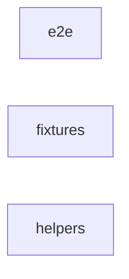

_Generated by CodeAtlas._

## Details

Owns 0 symbols across 2 file(s).

### e2e

Owns 4 symbols across 1 file(s).

**Related Classes/Methods:** _None_

**Source Files:**

- `frontend/tests/e2e/relationship-map.spec.ts`
  - `frontend.tests.e2e.relationship-map.spec.countNodes`
  - `frontend.tests.e2e.relationship-map.spec.findNodeByLabel`
  - `frontend.tests.e2e.relationship-map.spec.openRelationshipMap`
  - `frontend.tests.e2e.relationship-map.spec.triggerExport`

### fixtures

Owns 0 symbols across 1 file(s).

**Related Classes/Methods:** _None_

### helpers

Owns 24 symbols across 1 file(s).

**Related Classes/Methods:** _None_

**Source Files:**

- `frontend/tests/helpers/keyboard-stress.ts`
  - `frontend.tests.helpers.keyboard-stress.KeyboardStressTester`
  - `frontend.tests.helpers.keyboard-stress.KeyboardStressTester.alternatingTabDirection`
  - `frontend.tests.helpers.keyboard-stress.KeyboardStressTester.arrowKeyMashing`
  - `frontend.tests.helpers.keyboard-stress.KeyboardStressTester.assertFocusInContainer`
  - `frontend.tests.helpers.keyboard-stress.KeyboardStressTester.captureConsoleErrors`
  - `frontend.tests.helpers.keyboard-stress.KeyboardStressTester.captureUnhandledRejections`
  - `frontend.tests.helpers.keyboard-stress.KeyboardStressTester.constructor`
  - `frontend.tests.helpers.keyboard-stress.KeyboardStressTester.extremeSpeedTabCycles`
  - `frontend.tests.helpers.keyboard-stress.KeyboardStressTester.getFocusedElement`
  - `frontend.tests.helpers.keyboard-stress.KeyboardStressTester.getMemoryUsage`
  - `frontend.tests.helpers.keyboard-stress.KeyboardStressTester.heldModifierStress`
  - `frontend.tests.helpers.keyboard-stress.KeyboardStressTester.monitorFocusChanges`
  - `frontend.tests.helpers.keyboard-stress.KeyboardStressTester.rapidCtrlCombos`
  - `frontend.tests.helpers.keyboard-stress.KeyboardStressTester.rapidEnterPresses`
  - `frontend.tests.helpers.keyboard-stress.KeyboardStressTester.rapidEscapePresses`
  - `frontend.tests.helpers.keyboard-stress.KeyboardStressTester.rapidKeyPresses`
  - `frontend.tests.helpers.keyboard-stress.KeyboardStressTester.rapidPaste`
  - `frontend.tests.helpers.keyboard-stress.KeyboardStressTester.rapidTabCycles`
  - `frontend.tests.helpers.keyboard-stress.KeyboardStressTester.rapidTypeString`
  - `frontend.tests.helpers.keyboard-stress.KeyboardStressTester.rapidUndoSpam`
  - `frontend.tests.helpers.keyboard-stress.KeyboardStressTester.reverseTabCycles`
  - `frontend.tests.helpers.keyboard-stress.KeyboardStressTester.runStressTest`
  - `frontend.tests.helpers.keyboard-stress.KeyboardStressTester.sustainedKeyHold`
  - `frontend.tests.helpers.keyboard-stress.KeyboardStressTester.undoRedoCycling`
